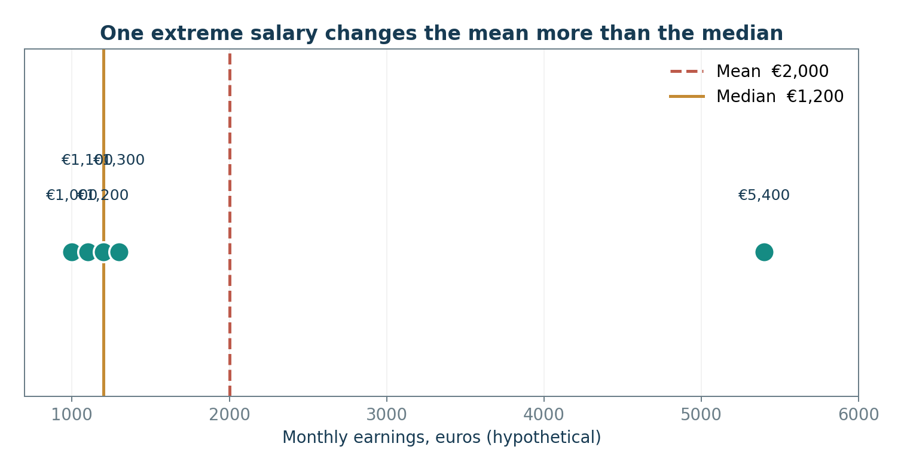

Suppose five fictional employees earn monthly amounts of €1,000, €1,100, €1,200, €1,300, and €5,400. The total is €10,000, so the <strong>arithmetic mean</strong> is €2,000. The <strong>median</strong>, the central observation after sorting, is €1,200. Both are correct. Yet the sentence “the average employee earns €2,000” may create a misleading picture of what most employees take home. Four of the five earn considerably less. The <strong>mode</strong>, the most frequent value, does not help here because every amount appears once.

Why not always use the median? Because different questions require different summaries. If the employer needs to budget total wages, the mean is directly connected to the total. If a prospective employee wants to understand a typical worker's pay, the median may be more informative. For household wealth and incomes, strongly right-skewed distributions can produce large differences between mean and median. A distribution is <strong>skewed</strong> when one tail stretches farther than the other; a large right tail may pull the mean upward.

Even the median hides important information. Consider two villages with median monthly incomes of €1,200. In the first, incomes cluster between €1,100 and €1,300. In the second, many people earn €600 and others €2,500, yet the middle observation still equals €1,200. The same median does not mean the same degree of inequality or security. A good summary states the centre and something about the distribution around it.

A <strong>weighted mean</strong> is appropriate when groups contribute different numbers of observations. If Store A sells 10 items at an average price of €2 and Store B sells 90 at an average price of €4, the overall item-weighted average is (10 × €2 + 90 × €4)/100 = €3.80. Simply averaging the stores' two means yields €3, which describes a different calculation: the mean of a randomly selected store's average price when both stores have equal weight. Neither calculation is an arithmetic error, but only one answers the question “What was the average price of an item sold?”

<figure class="figure" id="figure-6-2">

<figcaption>Figure 6.2. In this hypothetical group, a high value pulls the mean upward while the median stays near most observations. <a class="figure-anchor" href="#figure-6-2" aria-label="Link to this figure">#</a></figcaption>
</figure>
