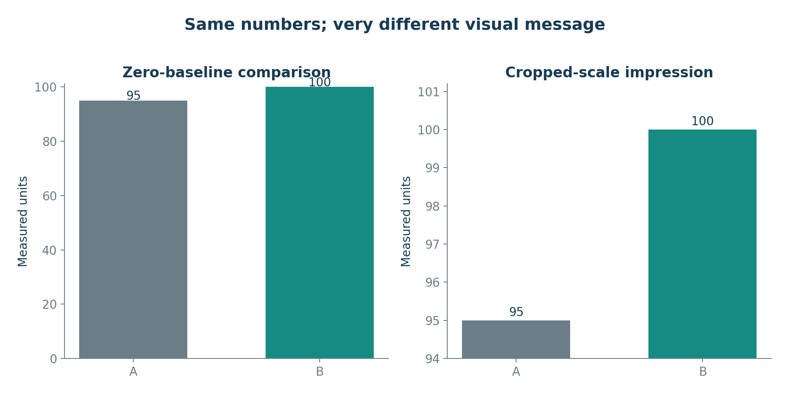

A chart is not just decoration around a claim. It is a machine for directing attention. <strong>Bar charts</strong> compare quantities through lengths; their bars usually ought to begin at a meaningful zero baseline when viewers will read length as magnitude. <strong>Line charts</strong> show ordered change across time, and a nonzero vertical axis can sometimes help reveal a small but important movement, provided it is plainly labeled. <strong>Histograms</strong> show distributions using bins, while <strong>scatterplots</strong> display relationships between paired observations. A chart type should match the data structure and the question.

Imagine a bar chart comparing 95 and 100 units. With a baseline at zero, the second bar is only about 5.3 percent taller. With a vertical scale beginning at 94, the visible heights above that baseline are 1 and 6; the second appears six times as tall. A truncated bar axis creates a very different emotional impression. For a line chart of a precision instrument, a truncated axis may be appropriate if the objective is to inspect a small change. The central issue is whether design invites viewers to infer a proportional magnitude the numbers do not support.

Other familiar tricks deserve attention: inconsistent interval spacing, changing units halfway through a series, exaggerated three-dimensional bars, axes that run in the opposite direction, multiple vertical scales that make unrelated trends overlap, and categories whose width or ordering misleads the eye. A geographic <strong>choropleth</strong> map shades regions by values and can exaggerate the importance of large sparsely populated areas; a density or rate may be fairer than a count. Color scales matter too: viewers often interpret dark colors as more important, even when boundaries are arbitrary.

<figure class="figure" id="figure-6-3">

<figcaption>Figure 6.3. Two bar charts with identical values; a cropped axis magnifies the apparent relative difference. <a class="figure-anchor" href="#figure-6-3" aria-label="Link to this figure">#</a></figcaption>
</figure>

A <strong>logarithmic scale</strong> is useful when quantities cover a wide range or when percentage growth is the focus. Equal steps on a base-10 logarithmic scale represent multiplication by 10, not addition of 10. A rise from 10 to 100 has the same vertical size as a rise from 100 to 1,000. That can illuminate exponential growth, but it can also confuse a reader who assumes ordinary equal-addition spacing. The axis label is part of the claim, not a technical footnote.
