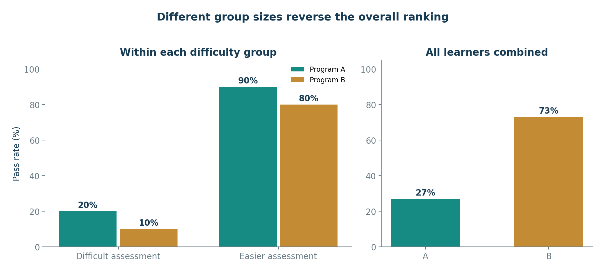

Two training programs, A and B, prepare learners for tests. Some learners attempt a difficult assessment; others take an easier one. Within <strong>each type of assessment</strong>, A achieves a higher pass rate. Yet when the two groups are combined, B's overall rate is much higher. How can both be true? The answer is not a mathematical trick: the programs served very different proportions of learners in each difficulty category.

Here is a deliberately hypothetical dataset. On the difficult assessment, A passes 18 out of 90 learners (20 percent), while B passes 1 out of 10 (10 percent). On the easier assessment, A passes 9 out of 10 (90 percent), while B passes 72 out of 90 (80 percent). Program A does better <em>within both difficulty groups</em>. But in total A passes 27 out of 100 (27 percent), while B passes 73 out of 100 (73 percent). Program A has most of its learners taking the hard test; Program B has most taking the easy one. The overall result reflects this striking difference in group composition.

<figure class="figure" id="figure-6-6">

<figcaption>Figure 6.6. Program A outperforms B within both difficulty categories, but B has a higher combined pass rate because group compositions differ. <a class="figure-anchor" href="#figure-6-6" aria-label="Link to this figure">#</a></figcaption>
</figure>

This is a form of <strong>Simpson's paradox</strong>, in which an association present within groups can reverse when those groups are aggregated. The name sounds mysterious, but the mechanism is understandable: when group sizes differ, the combined average weights the subgroups differently. Comparing the programs within each difficulty category is necessary before interpreting a total rate. It is also necessary to ask whether “difficulty category” captures all relevant differences. A superior descriptive rate within subgroups is not automatically a causal effect of the program.

The lesson travels widely. One hospital treats more complicated cases. One school serves more students with limited prior preparation. One city includes far more elderly residents. One company sells mostly low-margin goods and another mostly premium goods. If the group composition differs, the overall average can suggest a mistaken ranking. Better comparisons often require <strong>stratification</strong>, <strong>standardization</strong>, or statistical models. But the choice of which variables to control requires substantive understanding, not just mathematical cleverness.

A final warning: dividing everything into ever-smaller groups introduces other risks, including tiny samples, noisy rates and choices made after seeing results. Responsible analysts balance the need for fair comparison against the danger of producing fragile estimates. The paradox should make you more careful, not cynical about all aggregate statistics.
