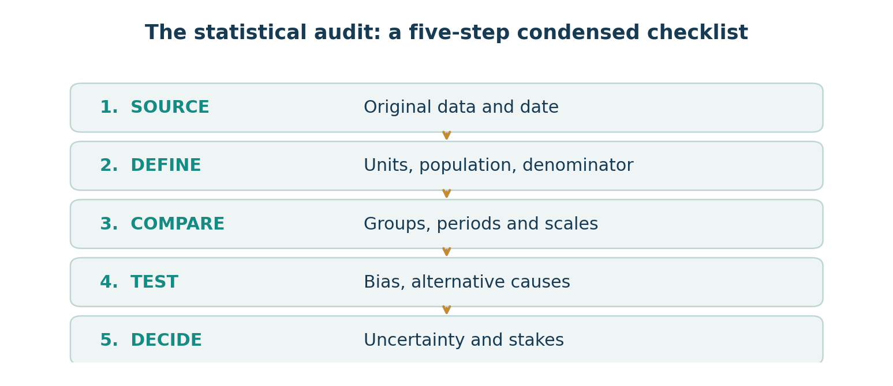

When you encounter a numerical claim, follow a short investigation. First, restate the claim in neutral language and identify the quantity. Second, locate the original data, publication date, and data producer. Third, name the unit of observation, the target population, the time period, and the denominator. Fourth, check the distribution, the comparison group, and the chart scale. Fifth, assess how observations were selected and how missing data were handled. Sixth, separate observed association from proposed causation and find at least one alternative explanation. Seventh, ask about uncertainty and what practical decision, if any, the evidence supports.

This is not a demand to calculate a confidence interval every time someone mentions a price. A quick claim may require only a quick check. But the stakes should determine the care you invest. A small mistake in a friendly conversation is one thing; a statistical mistake behind a major financial decision or public policy is another. Intellectual maturity includes knowing when the answer is obvious, when it is uncertain, and when you lack the information required to decide.

<figure class="figure" id="figure-6-8">

<figcaption>Figure 6.8. A condensed checklist for investigating a statistical claim before repeating it or making a decision. <a class="figure-anchor" href="#figure-6-8" aria-label="Link to this figure">#</a></figcaption>
</figure>

<strong>A final connection to the rest of the book:</strong> statistics cannot replace history, geography, economics or judgment. They depend on all of them. The same income series means different things under different political systems; a disease rate needs demographic context; a climate chart needs knowledge of physical measurement; an election result needs understanding of institutions. Numbers are strongest when they belong to a coherent explanation and weakest when detached from the lives and processes they describe.
