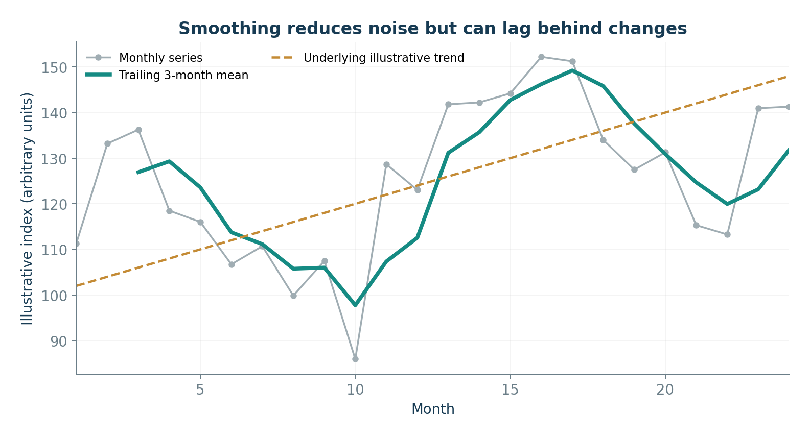

A <strong>time series</strong> measures something repeatedly through time. A line can look like steady progress when it starts at a low point, or stagnation when it starts at a peak. Selecting a start date after seeing the data is a form of <strong>cherry-picking</strong>. A dramatic annual change may reflect a pandemic, a war, an unusually severe winter, a tax change or a reporting revision rather than a lasting trend. Look at enough history to judge the claim, but not so much that you hide the specific change being discussed.

Seasonality matters enormously. Shops sell different goods at Christmas, vacation towns grow crowded in summer, and heating demand rises in winter. Comparing July revenue with December revenue may be less useful than comparing July with the previous July. Analysts often use <strong>seasonal adjustment</strong> or <strong>year-over-year change</strong> to make patterns easier to interpret. These methods help but do not eliminate underlying uncertainty. In a small shop, a one-off bulk customer can still dominate a monthly comparison.

A <strong>moving average</strong> smooths short-term variation. For monthly sales of €100, €120 and €80, the three-month average is €100. Add a fourth month of €160 and the new trailing three-month average becomes (€120 + €80 + €160)/3 = €120. Smoothing makes the broad pattern clearer but introduces lag and can conceal sudden changes. If an emergency is unfolding, a smoothed line may not be the best indicator for an immediate decision.

<figure class="figure" id="figure-6-4">

<figcaption>Figure 6.4. An invented time series showing raw observations, a trailing moving average and a schematic trend. <a class="figure-anchor" href="#figure-6-4" aria-label="Link to this figure">#</a></figcaption>
</figure>

Always ask whether a series is <strong>nominal</strong> or <strong>inflation-adjusted</strong>, whether its population has changed, and whether the definition changed over time. A century-long economic graph that switches borders, currencies or methods without disclosure invites false precision. Often the hardest part of studying the past is making unlike periods comparable without erasing the differences that make them interesting.
