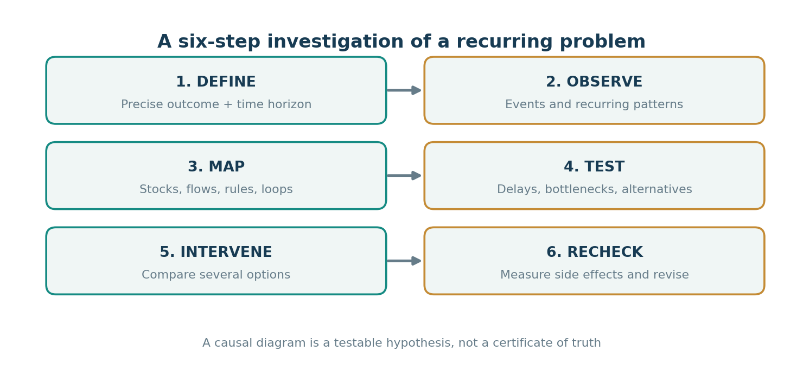

When you encounter a recurring problem, try this compact sequence. <strong>Define the outcome</strong> in measurable terms and choose a time horizon. <strong>Trace the pattern</strong> rather than relying on one dramatic event. <strong>Identify stocks and flows:</strong> what accumulates, what enters, what leaves? <strong>Map loops and delays:</strong> what changes behavior in response to changing conditions, and how late? <strong>Look for constraints and external effects:</strong> bottlenecks, shared resources, neglected people or costs pushed elsewhere. <strong>Propose more than one intervention</strong> and predict its intended and unintended consequences. <strong>Test and revise:</strong> decide what information would tell you the intervention is working.

A systems question is often more revealing than a blame question: <em>What rules or constraints could produce this behavior even among well-intentioned people?</em> But it should not replace moral judgment or responsibility. In a war, people still choose to invade or negotiate. In a company, managers still choose whether to deceive customers. In a public institution, officials still have duties. Structure explains incentives and constraints; it does not absolve individuals of their decisions.

The toolkit also protects against two opposite mistakes. One is <strong>reductionism</strong>, assuming a complex outcome must have one cause. The other is <strong>vagueness</strong>, saying everything is interconnected and therefore nothing definite can be known. The best systems thinker is specific: here are the actors, stocks, flows and mechanisms; here are the measurements; here is what is uncertain; here is a reasonable test.

<figure class="figure" id="figure-7-10">

<figcaption>Figure 7.10. A practical cycle turns systems hypotheses into observable tests and revised decisions. <a class="figure-anchor" href="#figure-7-10" aria-label="Link to this figure">#</a></figcaption>
</figure>
