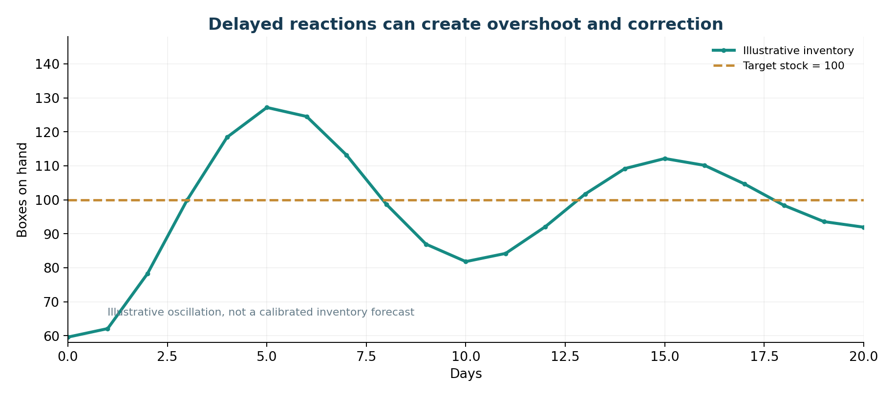

Imagine driving with a fogged windscreen and steering from where the road appeared to be several seconds ago. You turn right, wait, see no improvement, turn farther right—and then suddenly realize the car has already crossed the center line. Delayed information can make a corrective action excessive. This is a vivid form of a general systems problem: <strong>the response happens after the decision, while new decisions are made before the previous response has arrived</strong>.

Consider a fictional shop with a target inventory of 100 boxes and a five-day delivery delay. On Monday it sees 50 boxes, so it orders 50. On Tuesday it still sees 50, and orders another 50. If it overlooks outstanding orders, it may continue ordering until 250 boxes are on their way. When deliveries finally arrive, the shop is overstocked and starts cancelling orders. After some sales, it can swing toward shortage again. The particular arithmetic is illustrative; real ordering rules are usually more complicated. The key is that <strong>a delay plus aggressive correction and incomplete information</strong> can generate cycles.

Similar mechanisms can arise in construction, agricultural supply, education and healthcare. New housing takes years to complete, so current prices influence investments that arrive long after demand has changed. Training doctors takes many years, so a short-term shortage cannot be solved immediately by adding university places. In ecological management, a fish population may respond slowly to changes in harvesting pressure. If decisions rely on outdated measurements, managers risk overshooting a sustainable level.

A good response is not always to act faster. Sometimes the safer approach is to reduce the strength of each correction, account for commitments already made, improve the timeliness of information, or redesign the decision rule. Delays differ: administrative delay can sometimes be reduced, while biological growth or construction time cannot simply be wished away.

<figure class="figure" id="figure-7-4">

<figcaption>Figure 7.4. A schematic inventory oscillation illustrates why delayed feedback and repeated correction can overshoot. <a class="figure-anchor" href="#figure-7-4" aria-label="Link to this figure">#</a></figcaption>
</figure>
