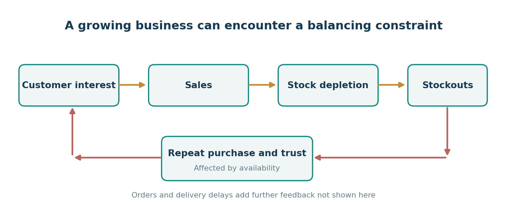

Consider a fictional town in which housing demand grows rapidly. Rents rise, signaling an opportunity to developers. But construction requires permits, financing, labor and time. New buildings may open two or three years after the original surge in demand. If many developers react to the same price signal at once, additional supply can arrive just as demand slows, creating vacancies and falling rents. This <strong>cobweb-type adjustment</strong> is possible under particular supply, demand and expectation conditions; it is not a universal prediction that every boom ends in a crash.

Prices do several jobs. They provide signals about scarcity, encourage changes in supply and demand, and coordinate decisions among people who do not know one another. But prices can be slow, noisy or incomplete indicators. A price may omit pollution costs, unpaid care work, future damage, or security risks. If a factory can discharge waste without bearing the downstream cost, its private calculation differs from the social cost. Economists call such effects <strong>externalities</strong>. Policies can sometimes improve the information and incentives in the system through standards, taxes, property rules, subsidies, or regulation, each with its own trade-offs.

Financial markets add expectations to feedback. Rising asset prices may attract attention and borrowing; increased demand can raise prices further. If participants believe prices can only go up, the loop may intensify. But higher valuations, credit constraints, changing expectations and market corrections may interrupt it. A simple positive-feedback description does not tell us when a bubble exists or how large a correction will be. Such judgments require evidence about fundamentals, financing, institutional conditions and the distribution of risk.

One of the most useful economic distinctions is between a <strong>flow deficit and a debt stock</strong>. A government running a deficit in a year adds to its debt stock under simplified accounting, though accounting details and other adjustments may matter. A household earning €2,000 and spending €2,200 monthly adds roughly €200 of borrowing or runs down savings each month; the total debt accumulated depends on its starting position, interest and repayments. Confusing a one-period flow with the accumulated stock can make public discussions of budgets almost meaningless.

<figure class="figure" id="figure-7-7">

<figcaption>Figure 7.7. Sales, availability and customer trust interact; real operations include further delayed processes. <a class="figure-anchor" href="#figure-7-7" aria-label="Link to this figure">#</a></figcaption>
</figure>
