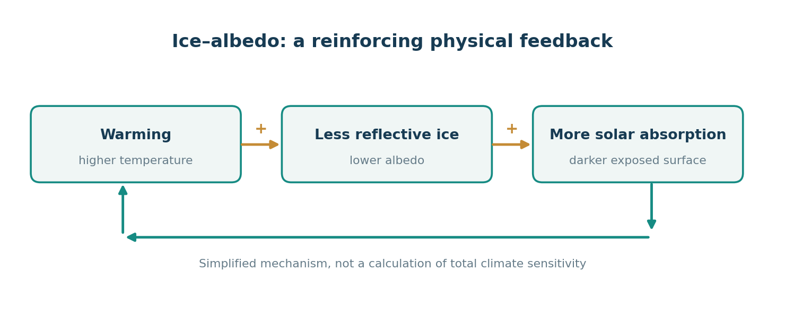

Earth is a system of interacting atmosphere, oceans, land, ice and living organisms. A change in one part can influence another and return to affect the original change. One of the clearest climate examples is the <strong>ice–albedo feedback</strong>. Snow and ice reflect more incoming sunlight than darker ocean or land surfaces. Warming can reduce snow or ice cover; exposed darker surfaces absorb more solar energy; this adds warming that can contribute to further melting. The loop is reinforcing in the sense defined earlier.

But a climate feedback must be placed within the broader physical picture. Earth's temperature also responds to changes in incoming and outgoing radiation and to many other feedbacks. The IPCC finds that the combined effect of known radiative feedbacks amplifies the warming response to human-caused forcing, while individual feedbacks—including different cloud effects—have distinct magnitudes and uncertainties. A simplified diagram can communicate the mechanism, but it cannot replace quantitative climate observations or a physical climate model.

Forests offer another instructive case. Vegetation influences water movement, local climate, soil stability and habitat. Land-use change can alter those interactions, but the direction and strength depend on region, climate and type of vegetation. It would be irresponsible to infer a precise global effect from the statement “more trees create more rain.” The scientifically useful systems question is not “Can we draw a loop?” but “How strong is it, under what conditions, and what observations could distinguish it from alternatives?”

People sometimes misread a reinforcing feedback as proof that catastrophe is guaranteed, or a balancing feedback as proof that nature will save itself. Neither follows. Physical limits, interacting loops, regional differences, human responses and long time delays all matter. Systems thinking helps organize the mechanisms; <strong>measurement and tested physical theory</strong> determine how confidently we can quantify them.

<figure class="figure" id="figure-7-6">

<figcaption>Figure 7.6. Lower ice cover reduces reflection and can amplify warming; the figure omits other climate processes. <a class="figure-anchor" href="#figure-7-6" aria-label="Link to this figure">#</a></figcaption>
</figure>
