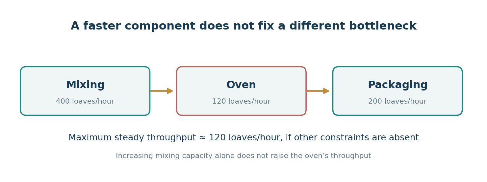

A network contains nodes and connections: airports and flight paths, websites and links, banks and payments, firms and suppliers, people and relationships. Networks allow resources and information to move, but their topology influences what can go wrong. A large port, bridge, data center or electrical transformer may connect many otherwise separate activities. When it fails, disruption can travel far beyond the original location.

A network's performance may depend more on its <strong>bottleneck</strong> than on its average component. Imagine a bakery able to mix 400 loaves' worth of dough per hour, bake only 120 and package 200. In steady operation, the oven limits total output to around 120 loaves per hour, provided other steps do not impose further constraints. Hiring more dough mixers will not raise the throughput past the oven's limit. The correct improvement is to test the constraint and the whole workflow before investing.

There is a trade-off between concentration and redundancy. Routing all transport through one hub may be efficient in ordinary conditions, but a breakdown can affect the entire network. Spreading traffic among several routes may provide resilience at an extra cost. Some redundancy is built into national electrical grids, communication networks and emergency systems for this reason. Yet duplication alone does not guarantee safety if all backup paths depend on the same vulnerable power supply or regulatory decision.

Network effects can be favorable as well as dangerous. A shared railway standard allows more people and freight to connect; common protocols allow computers to exchange information. Sometimes adding a link improves access, but in selfishly routed traffic networks a newly available road can under certain conditions worsen overall journey times—an idea known as <strong>Braess's paradox</strong>. This is a mathematical possibility with particular assumptions, not a claim that building roads generally makes traffic worse. It reminds us that the impact of a connection depends on how users adapt to it.

<figure class="figure" id="figure-7-5">

<figcaption>Figure 7.5. Throughput in a series of operations cannot exceed the slowest limiting stage. <a class="figure-anchor" href="#figure-7-5" aria-label="Link to this figure">#</a></figcaption>
</figure>
