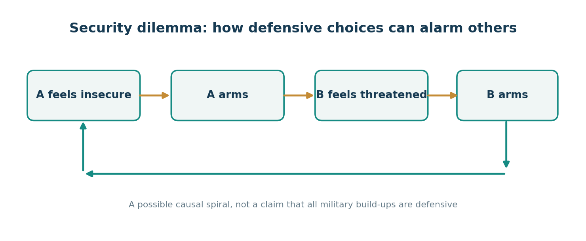

Systems thinking becomes particularly important when actors react to each other's expectations. Imagine two neighboring states that do not fully trust one another. State A buys defensive equipment to protect itself. State B observes the buildup but cannot be certain whether the equipment is purely defensive; B increases its own forces. A interprets B's response as evidence of danger and increases its forces again. Each state may be seeking security, yet the interaction can reduce mutual confidence and increase costs or risks.

This is the <strong>security dilemma</strong>, developed in international-relations scholarship and analyzed influentially by Robert Jervis. The concept does not excuse aggression or claim that all military buildups are innocent. States differ in intentions, capabilities and choices; some pursue territorial conquest, while others seek deterrence or defense. The dilemma is strongest when intentions are hard to verify and offensive and defensive capabilities are difficult to distinguish. Geography, technology, communication and credible commitments affect whether the spiral can be avoided.

Think of the feedback carefully: <strong>A's insecurity → A's military preparations → B's perceived threat → B's preparations → A's insecurity</strong>. Breaking the spiral can involve transparency, inspections, defensive postures that are easier to recognize, agreements, communication and institutions. But these measures face problems of trust and enforcement. In some situations, credible deterrence is itself an important part of stability. A serious account must examine context rather than insist that either more armament or unilateral disarmament automatically solves the problem.

Historical narratives often describe wars by naming a triggering event: an assassination, invasion, disputed election or diplomatic ultimatum. Triggers matter, but they operate within structures of alliances, military plans, domestic politics, power changes and expectations. Systems thinking can help identify these interacting causes without turning history into a machine that inevitably produces war. <strong>Human decisions and responsibility do not disappear just because the decisions occur within a system.</strong>

<figure class="figure" id="figure-7-8">

<figcaption>Figure 7.8. An illustrative mutual-threat spiral shows why intentions and perceptions matter in international relations. <a class="figure-anchor" href="#figure-7-8" aria-label="Link to this figure">#</a></figcaption>
</figure>
