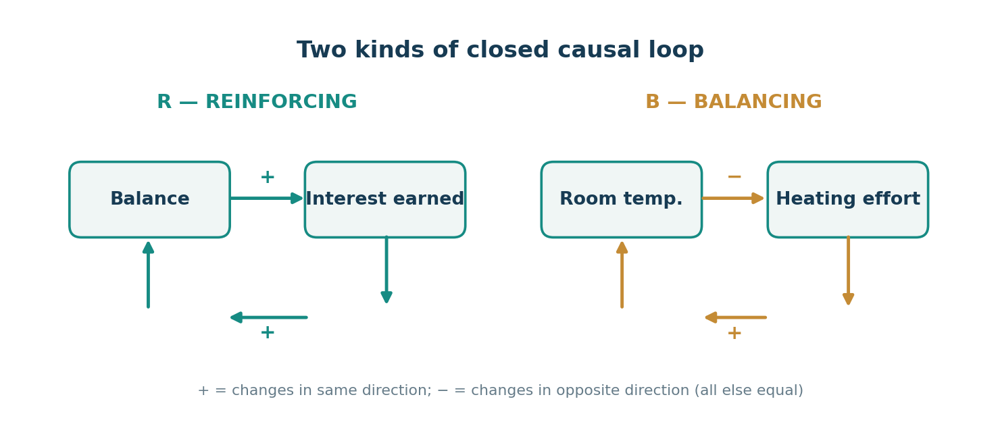

A <strong>feedback loop</strong> exists when a change in a system ultimately influences the conditions that caused it. A <strong>reinforcing loop</strong>, conventionally marked <strong>R</strong>, amplifies movement. If something grows, the loop may make it grow faster; if it shrinks, the same loop may accelerate the decline. Reinforcing is a description of the loop's direction, <strong>not a moral judgment that the loop is good</strong>.

A straightforward example is interest compounded into a savings account. A larger balance earns more interest; more interest increases the balance; that increased balance earns still more interest. At a constant positive interest rate, and absent withdrawals, that process can generate exponential growth. A successful marketplace can have another reinforcing mechanism: more buyers attract more sellers, and more sellers make the marketplace attractive to buyers. Such effects are not inevitable; congestion, costs, competition and limited demand may eventually counteract them.

There are destructive reinforcing loops too. In an illustrative soil-erosion cycle, loss of vegetation can expose soil to erosion; loss of soil makes regrowth harder; weaker vegetation can expose still more soil. In a financial panic, withdrawals may convince observers that a bank is unsafe, motivating additional withdrawals. The strength of such loops depends on specific conditions; not every fear becomes a bank run, and institutions such as deposit insurance can change the incentives.

Do not assume that reinforcing loops can continue without limit. Real systems encounter resource constraints, behavior change, regulation, technological adaptation and other feedback. Growing cities need housing and infrastructure; populations face birth and death dynamics; businesses face competitors. An unchecked reinforcing model can be useful for understanding early rapid change and misleading if extended indefinitely.

To draw a causal loop, identify a variable and the effect of a change. If an increase in A tends to increase B, other things equal, label the arrow <strong>+</strong>. If more A tends to decrease B, label it <strong>−</strong>. Follow the arrows around a closed chain. A loop with an even number of negative links is reinforcing; a loop with an odd number is balancing. That rule is a diagramming convention, not empirical proof that the stated relationships exist. Always test whether the claimed arrows make sense in the real case.

<figure class="figure" id="figure-7-3">

<figcaption>Figure 7.3. Reinforcing loops amplify a change; balancing loops counteract deviations from a goal. <a class="figure-anchor" href="#figure-7-3" aria-label="Link to this figure">#</a></figcaption>
</figure>
