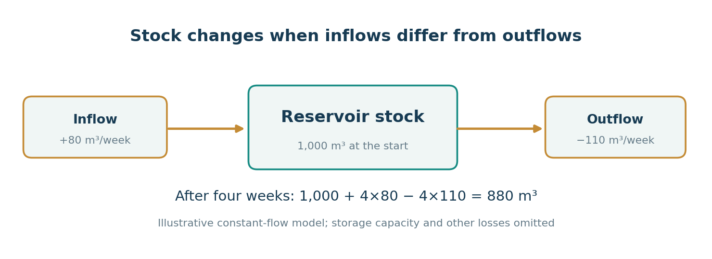

A <strong>stock</strong> is something accumulated at a point in time: water in a reservoir, money in a bank account, goods on shelves, carbon dioxide in the atmosphere, outstanding debt, trained personnel, or people living in a city. A <strong>flow</strong> is a rate that increases or decreases a stock: rainfall and withdrawals, income and spending, deliveries and purchases, emissions and removals, borrowing and repayment, hiring and departures, births and deaths.

Here is the essential accounting identity in plain language: <strong>next stock = current stock + inflows during the period − outflows during the period</strong>. More elaborate models add losses, transfers and measurement details, but the accounting principle remains. A flow has units per time; a stock does not. Confusing the two is a major source of misunderstanding in economics and public debate.

Consider a fictional reservoir containing 1,000 units of water. It gains 80 units each week from rainfall and loses 110 through irrigation and evaporation. After one week, it contains 970 units. After four weeks at those unchanged rates, it contains 880. Even if the rain looks impressive, the reservoir keeps shrinking because <strong>total outflows exceed total inflows</strong>. Asking only how much rain fell misses the condition of the stock.

Now suppose a shop starts with 300 units of inventory, receives 70 per day and sells 90 per day. After five days, inventory would be 200, assuming no spoilage and no additional changes. Selling more units is good for revenue in the short run, but if replenishment is consistently slower, high sales eventually create empty shelves. A manager who celebrates only the sales flow may fail to recognize a declining inventory stock until customers complain.

There is a crucial nuance: stocks are not always tangible. Trust between communities, organizational knowledge, soil fertility and institutional credibility can accumulate or erode, although measuring them is harder than counting cans in a warehouse. <strong>A hard-to-measure stock is not an excuse to pretend it has a precise number.</strong> We can identify mechanisms and use indicators while remaining candid about uncertainty.

<figure class="figure" id="figure-7-2">

<figcaption>Figure 7.2. Accumulations change when incoming and outgoing rates differ; illustrative constant-flow calculation. <a class="figure-anchor" href="#figure-7-2" aria-label="Link to this figure">#</a></figcaption>
</figure>
