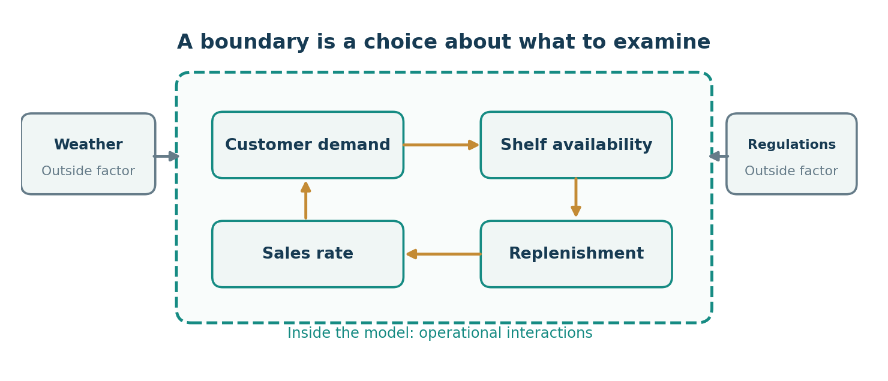

A <strong>system</strong> consists of elements whose relationships and interactions create a recognizable pattern of behavior over time. The elements might be people, institutions, machines, species, money, information or physical materials. The interactions may involve the exchange of energy, resources, signals, authority or expectations. Systems often have a purpose or function, though an ecological system does not need a conscious designer and a political system's stated purpose may differ from the outcomes it actually rewards.

A bicycle is a useful mechanical example: wheels, chain, pedals and brakes matter because of how they interact. A hospital is harder. It includes patients, workers, supplies, beds, schedules, information systems, regulations and public expectations. If a hospital purchases more beds but does not increase the number of qualified staff, its ability to treat patients may change little. Beds are components; <strong>staffing, patient flow and coordination</strong> help determine effective capacity.

The critical choice is where to draw the <strong>system boundary</strong>. Consider traffic on one road. You might study its intersections, signals and speed limits. But if drivers move onto neighboring streets when the road becomes crowded, those streets belong in the model as well. Expand the boundary to include commuting patterns, parking prices and public transport, and you may discover that a seemingly local congestion problem is partly caused by land-use decisions made years earlier. No boundary is uniquely correct: a good boundary includes the actors and processes needed to explain the question while excluding details that add little understanding.

A system also sits within a larger environment. Weather affects crop systems; trade policy affects supermarkets; a pandemic affects schools and hospitals. A model is a purposeful simplification, not a miniature copy of the universe. Always ask: Which variables have we included? Which actors are missing? What is assumed to remain constant? Over what period are we interested in the outcome?

An important distinction is <strong>complicated versus complex</strong>. A jet engine can be extremely complicated, yet many of its components behave predictably under defined conditions. A city is complex partly because people adapt to each other's actions. A rule meant to change one behavior can alter incentives and create new behavior that was never present in the original plan. There is no perfect dividing line, but the distinction reminds us that more detailed instructions do not always make a social system easier to control.

<figure class="figure" id="figure-7-1">

<figcaption>Figure 7.1. A useful boundary captures mechanisms relevant to a question while acknowledging influences outside it. <a class="figure-anchor" href="#figure-7-1" aria-label="Link to this figure">#</a></figcaption>
</figure>
