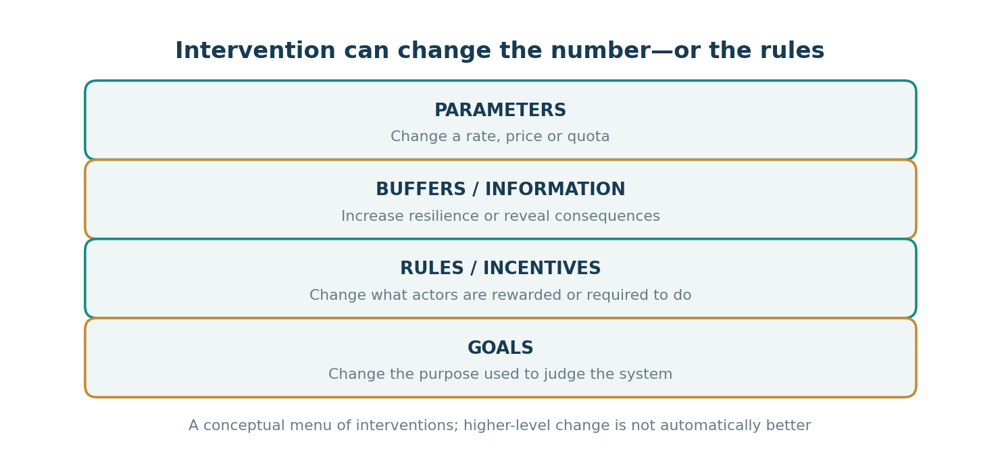

Donella Meadows famously proposed a hierarchy of <strong>leverage points</strong>, locations within a system where intervention can change behavior. The broad insight is that altering an underlying rule, goal or information flow may have more impact than repeatedly adjusting a numerical parameter. This is a framework for thinking, not a guaranteed ranking of interventions across every case. A simple change to a parameter can be vital in an emergency; changing an institution's goal can be politically difficult or produce unwanted side effects.

Return to a town with repeated water shortages. <strong>Parameter change:</strong> raise the reservoir's emergency rationing limit. <strong>Buffer change:</strong> add storage. <strong>Information change:</strong> publish real-time leak and use data. <strong>Rule change:</strong> require repairs, pricing reforms or usage restrictions. <strong>Goal change:</strong> shift from maximizing annual supply volume to maintaining reliable service and long-term aquifer health. Each acts at a different part of the system. None should be chosen without evidence about costs, rights, behavior and local conditions.

Consider four useful questions whenever an intervention is proposed. <strong>Does it remove the bottleneck?</strong> A new law may fail if enforcement capacity is missing. <strong>Does it shorten a harmful delay?</strong> Early warning helps if decision-makers can act. <strong>Does it change incentives?</strong> Transparency may matter only when someone has reason and ability to respond. <strong>Does it change the system's purpose?</strong> An institution optimized for cost cutting may deliver different outcomes from one explicitly judged on access, safety and long-term performance.

This gives systems thinking its practical power. It invites you to distinguish <strong>symptoms</strong> from <strong>structures</strong> while remembering that symptoms still need immediate care. If people are hungry, food relief is not irrelevant merely because agricultural policy needs reform. If a bridge is unsafe, closing it can be necessary even when the long-term solution involves maintenance budgets and infrastructure governance.

<figure class="figure" id="figure-7-9">

<figcaption>Figure 7.9. Interventions can alter parameters, buffers, information, rules and goals; no choice is universally best. <a class="figure-anchor" href="#figure-7-9" aria-label="Link to this figure">#</a></figcaption>
</figure>
