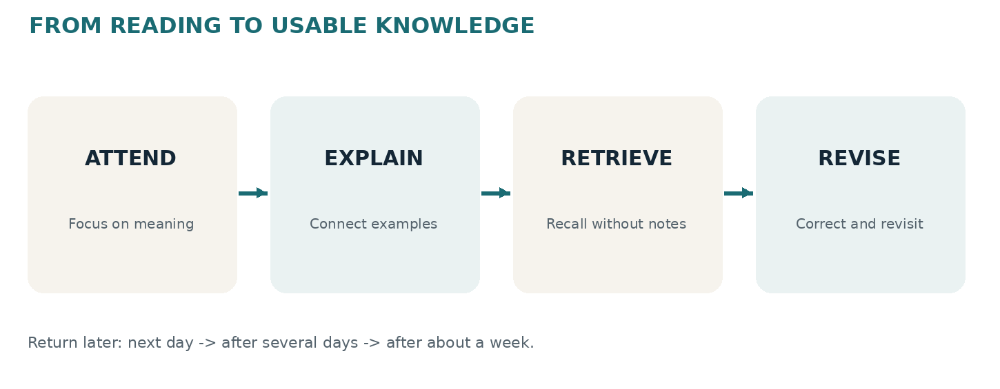

After several readings, a paragraph looks familiar. You may feel that you could explain it. But familiarity can be generated by repeated exposure, and it does not always predict successful recall a week later. Highlighting sentences and copying passages may help you find key material or organize notes, but neither reliably guarantees durable learning when used alone.

<strong>Retrieval practice</strong> is a more demanding alternative: close the book and attempt to reproduce the main ideas from memory. Ask yourself what caused an event, how a concept differs from another, or what the pieces of an argument are. Then check your answer. Even an unsuccessful attempt can help when followed by corrective feedback, provided the attempt is productive rather than a frustrating guessing marathon.

Instead of rereading a whole section about map projections, ask: 'Why can't a flat map preserve area and shape everywhere? What is Mercator particularly useful for? Why can Greenland appear too large?' If you can answer without the text, you are rehearsing the actual skill you want later: retrieving information when somebody asks you a question.

Retrieval should be <strong>effortful but achievable</strong>. If a chapter is completely unfamiliar, you need initial explanation and examples before testing. If you cannot remember anything, review a small cue or part of the answer and try again. A method is not useful merely because it feels difficult. Productive challenge, feedback, and an appropriate task matter.

<figure class="figure" id="figure-8-1">

<figcaption>Figure 8.1. A repeatable path from first exposure to usable understanding. <a class="figure-anchor" href="#figure-8-1" aria-label="Link to this figure">#</a></figcaption>
</figure>
