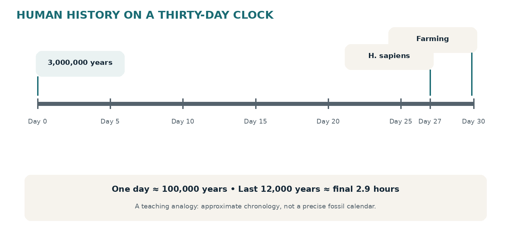

<figure class="figure" id="figure-9-5">

<figcaption>Figure 9.5. Three million years compressed into a thirty-day thought experiment. <a class="figure-anchor" href="#figure-9-5" aria-label="Link to this figure">#</a></figcaption>
</figure>

Place your own life beside these dates. Written records occupy only a very short closing portion of the human story. Farming occupies a longer but still comparatively brief part. Our species has existed on the order of hundreds of thousands of years. Hominins have existed for millions. The emergence of human-looking behavior was spread across vast periods that no single life could witness.

Here is a useful exercise in scale. Imagine that <strong>three million years</strong> were compressed into a single <strong>30-day month</strong>. Each day would represent <strong>100,000 years</strong>. Our species' approximate 300,000-year history would occupy only the final <strong>three days</strong>. The last 12,000 years would be about <strong>2.9 hours</strong> at the end of the month. If writing began around five thousand years ago in some regions, its history would occupy about <strong>72 minutes</strong>. These are illustrative proportional conversions, not exact dates for a single worldwide transition. They show why a history beginning with kings and wars leaves almost the entire human story out.

The best framework is to remember a few anchors and their implications, not to cram every competing fossil age. Walking on two legs preceded our species by millions of years. Tools were made before our genus was fully established. Earlier hominins traveled beyond Africa long before modern humans did. Our species evolved in Africa hundreds of thousands of years ago. Modern human expansion entailed encounters and genetic mixing. Human settlement of continents unfolded over long and uneven periods. Farming eventually transformed the relationship between communities and land, but it came late.
