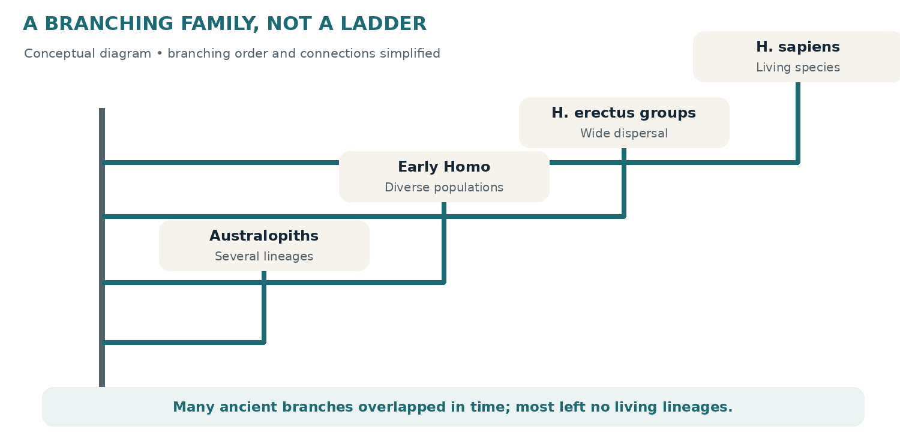

The earliest several million years of our branch are predominantly an African story. The fossil evidence for hominins roughly between six and two million years ago comes from Africa. That is not because other continents were unimportant to later evolution, but because the available record points to African origins and a long development there before members of the genus <em>Homo</em> spread widely into Eurasia. \[<a href="/009-human-evolution-and-the-first-migrations/sources/#source-2" class="cite">2</a>\]

Africa was never a single unchanging environment. Over enormous spans of time, rainfall patterns shifted; woodlands expanded or contracted; grasslands spread in some regions; lakes formed and dried; volcanic activity buried traces of life; and animal communities changed. Different environments offered different resources and pressures. Researchers examine fossilized pollen, animal teeth, sediment layers, isotopes, and landscape geology to reconstruct these conditions. Even after doing so, we should resist the neat tale that 'the forest disappeared, so humans stood up.' Upright walking has a complicated history and may have offered different advantages under different conditions.

An especially revealing discovery comes from Laetoli. The footprints indicate that bipedal walking—the ability to move on two legs—was established long before our species arose. Bipedalism was not an instant invention: early hominins combined traits useful for walking with others that helped in climbing. Scientists study the pelvis, knee, ankle, vertebral column, and big toe to infer how different species moved. A single fossil may not preserve all those features, which is another reason reconstructions are cautious. \[<a href="/009-human-evolution-and-the-first-migrations/sources/#source-1" class="cite">1</a>\]

One famous species is <em>Australopithecus afarensis</em>, known from eastern African fossils dated broadly between about 3.9 and 2.9 million years ago. The partial skeleton nicknamed Lucy, found in Ethiopia in 1974, helped researchers understand a body that was capable of upright walking but differed in many ways from ours. Lucy was not literally 'the first human,' nor can we confidently identify her as anyone's direct ancestor. She is evidence for a population near important branches in the family tree. An individual fossil is a window, not a complete genealogy.

Other australopiths and related hominins lived in different regions and periods. Some had robust chewing structures; others had different body proportions or dental patterns. Because fossils are rare and unevenly preserved, the recognized family tree changes as finds accumulate. To say that early human history is 'complex' is not avoiding an answer. It is reporting what happens when several related lineages exist simultaneously and the evidence connects them imperfectly.

The appearance of the genus <em>Homo</em> did not instantly replace all older forms. Early <em>Homo</em> populations overlapped with australopith or other hominin populations. Labels such as <em>Homo habilis</em> and <em>Homo rudolfensis</em> help organize fossils, but the exact boundaries and relationships remain debated. The family tree is best imagined as a bush: branches that split, overlap in time, sometimes disappear, and do not obligingly leave fossils at each fork.

<figure class="figure" id="figure-9-1">

<figcaption>Figure 9.1. A conceptual reminder that ancient human relatives formed overlapping branches; not a literal family tree. <a class="figure-anchor" href="#figure-9-1" aria-label="Link to this figure">#</a></figcaption>
</figure>
