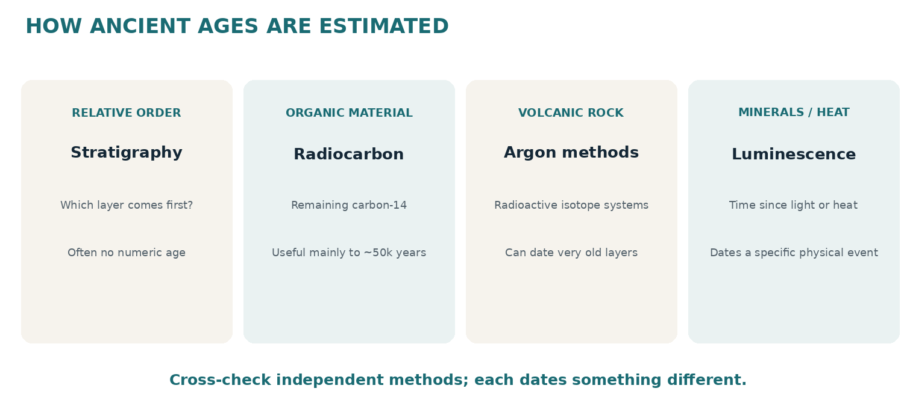

A fossil has no label announcing its date. Archaeologists and geologists establish ages by studying the physical context and applying several methods, each with its own assumptions. This deserves attention because a date is often the hinge on which an account of origins turns. The difference between a find dated to 45,000 years ago and one dated to 70,000 can alter entire migration models. The spectacular headlines are built on technical work that readers rarely see.

<strong>Stratigraphy</strong> begins with layers. In an undisturbed sediment sequence, lower layers are usually older than those above them. This is a relative ordering, not an automatic numerical date. Burrowing animals, later digging, erosion, geological movement, and redeposition can disrupt the pattern. A bone lying near a tool is not necessarily the same age as the tool. Archaeologists record the precise positions of artifacts and study whether they share an intact layer.

<strong>Radiocarbon dating</strong> uses the radioactive decay of carbon-14 in once-living material. When an organism dies, it stops regularly exchanging carbon with the environment, and its carbon-14 concentration gradually declines. Under suitable conditions the remaining fraction can help estimate an age. The method is most useful for material up to roughly <strong>50,000 years old</strong>, though the effective limit depends on sample quality and laboratory conditions. Contamination by more recent carbon can make an ancient sample appear younger; 'old' carbon in aquatic reservoirs can make some samples appear older. Calibration is essential because atmospheric carbon-14 levels have varied.

Older finds often require other techniques. <strong>Potassium-argon and argon-argon dating</strong> can date volcanic materials, which may place bounds on fossils or tools embedded between dated layers. <strong>Uranium-series methods</strong> investigate radioactive processes in suitable deposits, including some cave formations. <strong>Luminescence dating</strong> can estimate when mineral grains were last exposed to sunlight or heated, and thermoluminescence can help date certain heated artifacts. Each method measures a specific physical process—not 'the age of everything nearby.'

The strongest archaeological chronology often combines independent approaches. Imagine footprints in a sequence of ancient lake sediments. Researchers may date seeds, terrestrial pollen, and minerals in the layers, then ask whether the results agree with geology and climate evidence. The <strong>White Sands</strong> research in North America illustrates this approach: new independent methods supported an age estimate of about <strong>21,000–23,000 years</strong> for human footprints, challenging older assumptions about settlement dates. The significance lies not simply in a dramatic date but in how scientists tested the date after objections were raised. \[<a href="/009-human-evolution-and-the-first-migrations/sources/#source-7" class="cite">7</a>\]

<figure class="figure" id="figure-9-2">

<figcaption>Figure 9.2. Different scientific dating methods constrain different events or materials. <a class="figure-anchor" href="#figure-9-2" aria-label="Link to this figure">#</a></figcaption>
</figure>

Dating remains an exercise in probability, not mystical precision. A result such as <strong>315,000 ± 34,000 years</strong> expresses an estimated age and uncertainty under a particular technique. It does not mean a researcher watched a person living precisely 315,000 years ago. Even when the best estimate is reliable, methods may disagree because they date different events: the making of a tool, the burial of a bone, the formation of a covering deposit, or the last exposure of sand to sunlight.

<strong>A useful reader's question:</strong> When an article says 'the oldest human evidence,' ask: oldest <em>what</em>? Oldest fossil classified as our species? Oldest human-family footprint? Oldest stone tool? Oldest trace of life on a continent? These are different claims, and the distinction prevents many misleading debates.
