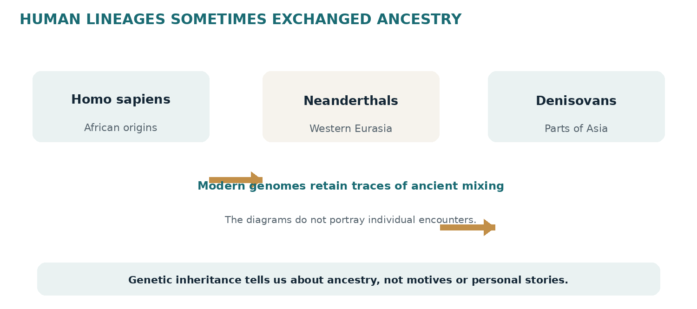

For generations, Neanderthals were depicted as crude, brutish failures: stooped figures unable to match the supposed brilliance of modern humans. This stereotype is poor science and poor history. Neanderthals were human relatives who lived across Europe and parts of western Asia for hundreds of thousands of years. They had large brains relative to body size, sophisticated stone technologies, and capacities for complex behavior. Their lives varied with region and time, as any long-lived population's would. They were neither identical to us nor mere caricatures. \[<a href="/009-human-evolution-and-the-first-migrations/sources/#source-9" class="cite">9</a>\]

The disappearance of Neanderthals around <strong>40,000 years ago</strong> remains an active subject of research. Climate fluctuations, small and fragmented populations, competition, demographic processes, and interaction with expanding <em>Homo sapiens</em> populations may all have mattered. There is no scientific warrant for an easy morality tale in which one species 'deserved' to survive. Some local populations disappeared; others contributed genetic material to descendants through interbreeding. The boundary between extinction and ancestry is more complicated than a simple replacement story.

The genetic revolution changed the debate. Ancient DNA extracted from human remains can be compared with DNA from living people. For many people whose ancestry is largely outside Africa, <strong>roughly 1–3 percent</strong> of their genomes derives from Neanderthal ancestors, with variation across individuals and populations. Ancient migrations back into Africa and other demographic processes mean Neanderthal-derived DNA is not confined neatly to non-African populations. These proportions describe genomic ancestry, not a person's moral or intellectual value. \[<a href="/009-human-evolution-and-the-first-migrations/sources/#source-10" class="cite">10</a>\]

DNA also revealed a group called the <strong>Denisovans</strong>, first recognized through genetic evidence from sparse remains in Siberia. Subsequent fossils and genetic clues point to a more geographically varied story in Asia. Denisovan-related ancestry contributes to some modern populations, particularly in parts of Oceania and Asia, and the genetic patterns indicate that mixing happened more than once. The very discovery of Denisovans shows how a huge population history can remain almost invisible when fossils are scarce. \[<a href="/009-human-evolution-and-the-first-migrations/sources/#source-10" class="cite">10</a>\]

A 2024 genomic analysis of ancient modern humans suggested that a significant episode of Neanderthal admixture shared across many present-day non-African lineages occurred around <strong>45,000–49,000 years ago</strong>. This is not a claim that all human-Neanderthal contact occurred on one afternoon or only once. Earlier interactions are also evidenced; admixture estimates depend on the sampled genomes and the genetic questions being asked. It does remind us, however, that genetic data can constrain events far more closely than a map of scattered bones alone. \[<a href="/009-human-evolution-and-the-first-migrations/sources/#source-11" class="cite">11</a>\]

<figure class="figure" id="figure-9-3">

<figcaption>Figure 9.3. Ancient human populations both diverged and sometimes exchanged ancestry; schematic only. <a class="figure-anchor" href="#figure-9-3" aria-label="Link to this figure">#</a></figcaption>
</figure>

## Why the word 'interbreeding' matters

Some textbook diagrams show a pristine tree: one branch separates from another and never touches again. Genetic evidence shows that the branches in human history sometimes <strong>reconnected</strong>. Ancestors who had diverged for many generations could still have children together under some circumstances. Their descendants carried inherited variants onward. Such mixing does not make all populations 'the same species' in any simple taxonomy, nor does it make every ancient encounter knowable. It tells us that a model with only clean splits misses a real part of the story.

We should also avoid romanticizing or sensationalizing ancient encounters. DNA can reveal shared ancestry; it cannot tell us whether a particular encounter involved friendship, coercion, exchange, family ties, or conflict. Human lives are richer than the surviving genetic signal. Science can answer many questions, but it has different degrees of access to different kinds of experience.
