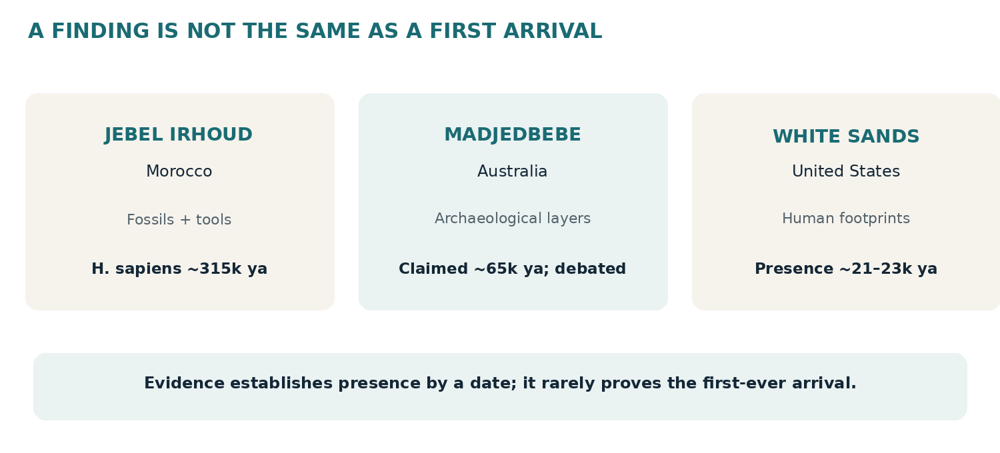

The Americas form a particularly instructive case because the best-known textbook story has changed dramatically. For much of the twentieth century, accounts often linked the earliest settlement closely to <strong>Clovis</strong> stone-tool traditions, dated to roughly 13,000 years ago. The idea of 'Clovis first' eventually faced convincing evidence of older occupations. Research has continued to move back the plausible dates, revise routes, and show how difficult it is to prove an absolute first arrival.

During cold periods, lower sea level exposed <strong>Beringia</strong>, a broad region joining what is now northeastern Asia and northwestern North America. But crossing Beringia would not have guaranteed entry into all parts of the continent. Ice sheets could block inland passages, and an ice-free corridor's existence at one date does not prove that it could support a human migration then. A <strong>Pacific coastal route</strong> is one plausible pathway; some early coastal sites may now be submerged because sea levels later rose. The evidence fits a more complex picture than a single line of people marching south between glaciers.

One discovery crystallized the debate. Researchers identified footprints at <strong>White Sands National Park</strong> in New Mexico in ancient lake-margin deposits. A 2021 age estimate placed the prints at approximately 21,000–23,000 years ago, much earlier than the classic Clovis chronology. Skeptics questioned whether radiocarbon dating of aquatic seeds might be affected by an old-carbon reservoir. Later studies dated <strong>terrestrial pollen</strong> and examined <strong>luminescence</strong> in the surrounding sediments; results supported the older estimate. A 2025 U.S. Geological Survey synthesis described multiple independent lines of evidence for human presence during the Last Glacial Maximum. \[<a href="/009-human-evolution-and-the-first-migrations/sources/#source-7" class="cite">7</a>\]

<figure class="figure" id="figure-9-4">

<figcaption>Figure 9.4. A find establishes local presence by a date, not the exact time of first arrival. <a class="figure-anchor" href="#figure-9-4" aria-label="Link to this figure">#</a></figcaption>
</figure>

Does that settle every question? No. It strengthens the case for human presence at White Sands during the stated period. It does not reveal the people's languages, social relationships, exact ancestors, or all the routes by which earlier populations entered the continent. Individual dates do not automatically reconstruct a continental settlement process. Nor do they tell us that every ancestral community of later Indigenous American populations descended from that specific group. Multiple movements, regional continuity, and later change must be studied through many lines of evidence.

This is an important lesson for reading archaeological headlines. When you hear that the 'first Americans were here 23,000 years ago,' a careful translation is: strong evidence indicates <strong>some humans were present in one part of North America by that time</strong>. Earlier arrivals remain possible; the date is not a biography of an entire continent. The distinction between <strong>earliest discovered evidence</strong> and <strong>earliest actual presence</strong> is essential. Archaeology works with what survives and is found, not with everything that once happened.
