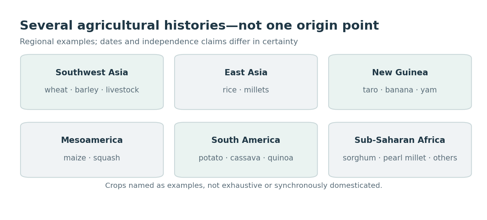

Agriculture across Africa likewise emerged through varied pathways. Different zones adopted and developed crops and herding according to their ecologies. Northeast Africa had long connections with Southwest Asian domesticates in some areas, while other African regions developed indigenous domesticated crops, including pearl millet, sorghum and African rice across different histories. Their precise origins and timelines differ and remain subjects of archaeological research. \[<a href="/010-the-agricultural-revolution/sources/#source-2" class="cite">2</a>\]

The Sahara is particularly instructive. Its past was not uniformly like today's arid landscape. During wetter periods in the early and middle Holocene, lakes, grasslands and waterways supported varied communities, including populations engaged in animal management. Later drying transformed routes, settlement possibilities and livelihoods. We should not infer that a single drought forced all African communities into one agricultural system. People responded in multiple ways, and the dates and processes varied regionally.

In the Sahel and across savanna ecologies, grains that could survive demanding rainfall patterns became valuable. Farther south, different ecological zones encouraged other crop combinations, local innovations and exchanges. Stories about the origin of farming based solely on the Fertile Crescent unintentionally erase much of this history. A global account must treat African knowledge and domestication as central, not as a late appendix.

<figure class="figure" id="figure-10-3">

<figcaption>Figure 10.3. Selected regions and crops associated with distinct histories of early agriculture; not a literal map or a single date. <a class="figure-anchor" href="#figure-10-3" aria-label="Link to this figure">#</a></figcaption>
</figure>
