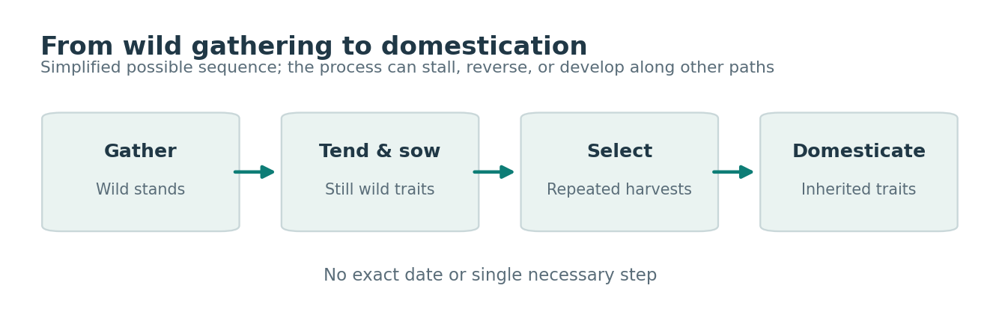

Three words are often used interchangeably: gathering, cultivation and domestication. They describe related but distinct processes.

<em>Gathering</em> means collecting plants that grow without necessarily arranging their reproduction. <em>Cultivation</em> means actively tending or planting useful plants, including plants that might still be biologically wild. <em>Domestication</em> refers to evolutionary changes in plant or animal populations caused by sustained relationships with humans and human-shaped environments. A household can cultivate wild plants. It can also obtain fully domesticated grain through exchange without growing it. Agricultural systems are built from combinations of practices, not one magical threshold.

Think about a wild cereal. When it matures, the seed head often becomes brittle and breaks apart, distributing seeds into the soil. That is advantageous for the plant in the wild. For someone harvesting grain, however, seeds that fall before collection can mean a lost meal. Over many harvests, some plants retain their seeds longer because of inherited variation. If people preferentially gather, carry, sow, and protect these plants, the proportion of seed-retaining forms can rise. Eventually a cultivated population may become increasingly dependent on humans to disperse its seeds.

The archaeological clue is small: fragments of the central axis of a cereal head, called the <em>rachis</em>. Researchers examine how it broke and quantify the proportions of 'wild-type' and 'domesticated-type' forms. This is not a perfect one-grain test; variation, preservation and identification can complicate it. Yet across many remains and well-dated layers, those little fragments can chart centuries of human-plant coevolution. Research suggests that several familiar domestication traits appeared gradually rather than in one brief episode. \[<a href="/010-the-agricultural-revolution/sources/#source-3" class="cite">3</a>\]\[<a href="/010-the-agricultural-revolution/sources/#source-4" class="cite">4</a>\]

Animal domestication introduces another set of relationships. People might first hunt a species, later protect or manage its movements, and eventually breed animals whose reproduction and behavior are deeply shaped by humans. The earliest domesticates did not all serve the same function. Sheep and goats offered meat and other resources; cattle could provide meat and, in later agricultural systems, traction and dairy products; pigs followed a different ecological and management path. A domesticated animal is not simply a tame individual. Tameness concerns one animal's behavior; domestication describes lasting population-level change.

This distinction matters because an archaeological site can contain evidence for one process without proving another. Grinding stones demonstrate food processing, not necessarily farming. Animal bones may show hunting rather than herding. Stored seeds can be gathered wild foods. Strong interpretations usually rest on <em>several</em> clues: species composition, plant morphology, kill-off patterns in animal herds, structures, tools, soil disturbance, genetics, and regional sequences.

<figure class="figure" id="figure-10-1">

<figcaption>Figure 10.1. A simplified sequence: human management and inherited plant traits can change together across generations. <a class="figure-anchor" href="#figure-10-1" aria-label="Link to this figure">#</a></figcaption>
</figure>
