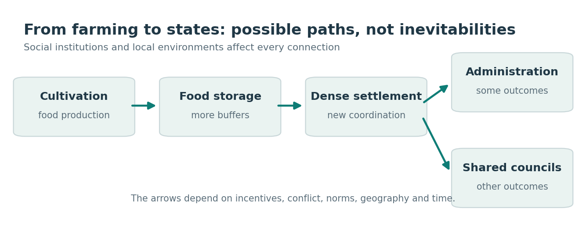

When some households produce more food than they immediately consume, other activities can expand. People may spend more time making tools, building structures, participating in rituals, exchanging goods or managing shared resources. But the concept of <em>surplus</em> is subtler than a stack of spare grain. Food must be edible, storable, transportable and socially accessible. A seasonal surplus that spoils before trade is not equivalent to a reliable annual flow of resources.

Specialization also predates agriculture. Foragers made elaborate tools, ornaments and art, and many maintained long-distance exchange. What increasingly dense agricultural settlements could change was the scale and regularity of certain specializations and the ability to sustain people concentrated in one location. More food producers per square kilometre can support more diverse labor, but the arrangement depends on production, distribution and institutions.

The relationship between agriculture and states is therefore indirect. Early governments did not arise simply because wheat was invented. Political authority could emerge through combinations of population concentration, conflict, defense, ritual coordination, irrigation, trade, storage, taxation and elite strategies. Some farming communities remained relatively decentralized for long periods. Some nonfarming societies formed complex political organizations. Later Mesopotamia provides an especially important case of how agriculture, cities, temples, administration and writing became linked—but those links are the subject of our next chapter, not the first moment of domestication.

<figure class="figure" id="figure-10-6">

<figcaption>Figure 10.6. Agriculture created opportunities for several forms of social organization; state formation was not automatic. <a class="figure-anchor" href="#figure-10-6" aria-label="Link to this figure">#</a></figcaption>
</figure>

The story is easier to understand as a chain of conditional possibilities. Cultivation can increase output from a given area. More reliable output can encourage permanent settlement. Permanent settlement can support denser populations and complex exchange. Dense networks can make coordination valuable. Coordination can be shared, negotiated or captured by powerful groups. None of those arrows works without conditions, and a society can take alternative routes at each stage.
