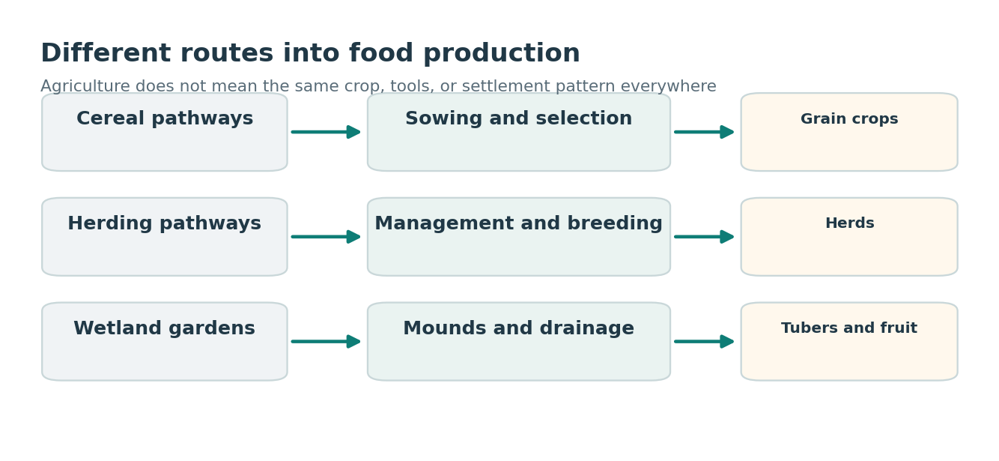

Crops require attention at certain points in a seasonal cycle. Animals add a different daily rhythm. A herd must be watched, watered, protected, moved or confined. Managing a breeding population requires decisions about which animals reproduce and which are slaughtered. Some choices become visible to archaeology because herd structures differ from the age and sex patterns expected in selective hunting.

A goat or sheep herd can turn vegetation humans cannot digest directly into food and other materials. Herds can also accumulate wealth on the move and become a source of social obligations, bridewealth, inheritance and conflict in societies where those institutions exist. But herding has costs. Animals consume forage and water, can spread pathogens, and may compete with fields for land. A drought or epidemic can destroy years of accumulated stock.

The boundary between farming and pastoralism is not clean. People might combine a small grain plot with a seasonally moving herd. Neighbors may exchange cereals for milk, wool or animals. Later trading routes and political alliances could rest on these complementary economies. We should resist describing mobile herders as somehow 'behind' settled farmers. Mobility can be the most sensible technology in lands where rainfall is uncertain and grass grows across large seasonal ranges.

When farmers and herders did meet, relations ranged from trade and intermarriage to competition and violence. Later chapters will explore how those relationships shaped empires and frontiers. For now, the key point is that domesticated animals made a new form of food production possible, but not one universal model of rural life.

<figure class="figure" id="figure-10-2">

<figcaption>Figure 10.2. Different pathways to food production involved different species, landscapes and forms of labor. <a class="figure-anchor" href="#figure-10-2" aria-label="Link to this figure">#</a></figcaption>
</figure>
