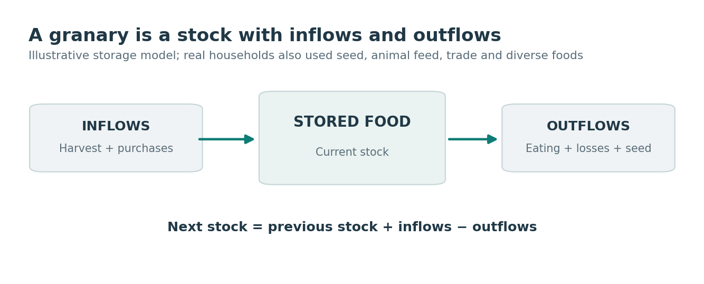

Perhaps the most important agricultural building was sometimes not a palace or temple but a storehouse. Fields produce food unevenly across the year. A successful harvest may have to sustain people through months before the next one. Storage can move food through time. It also creates a new problem: valuable concentrated supplies must be protected from moisture, pests, spoilage and theft.

Imagine a hypothetical family of five that plans to eat, on average, half a kilogram of stored grain per person each day. Over 365 days it would require 5 × 0.5 × 365 = <strong>912.5 kilograms</strong> of edible grain. If the family expects 20% of stored grain to be lost, it needs to begin with 912.5 ÷ 0.8 = <strong>1,140.625 kilograms</strong> for that particular use. This is a <em>teaching calculation</em>, not a reconstruction of an ancient diet: real families consumed diverse foods, planted some seed, traded, fed animals, and experienced variable loss rates.

Why do this arithmetic in a history book? Because agriculture created a relationship between a harvest, population, risk and obligation that can be studied quantitatively. A larger harvest does not automatically mean an equal increase in edible surplus. Some output must be reserved for seed, storage losses, exchange, religious offerings, animal feed or other uses. Labor to build storage and secure it is also a cost.

A village may solve such problems through household granaries, kinship redistribution, communal deposits, reciprocal exchange or stronger leaders who organize and control reserves. Those institutions produce different political consequences. A shared store can provide famine insurance; it can also create leverage for the person who holds the key. Archaeologists therefore study not only how much grain was produced, but also where storage was located and who could access it.

<figure class="figure" id="figure-10-5">

<figcaption>Figure 10.5. Food in storage is a stock; harvesting and eating change it through time. <a class="figure-anchor" href="#figure-10-5" aria-label="Link to this figure">#</a></figcaption>
</figure>

Storage illustrates a general principle from Chapter 7. Accumulated food is a <em>stock</em>. Harvest, trade and collection are inflows; eating, spoilage, seed use and transfers are outflows. If a drought reduces inflow, an existing store can buffer the shock. But if food use consistently exceeds replenishment, the buffer eventually disappears. In later cities, the management of food stocks would become tied to taxation, records, wages and political legitimacy.
