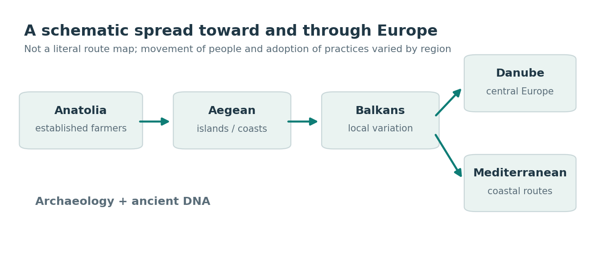

Farming in Europe did not originate as a copy made simultaneously by every community. Its spread involved migrations of people, exchange of techniques, intermarriage, encounters with existing foragers and adjustments to unfamiliar climates. Archaeology and ancient DNA have made one point especially clear: the movement of farming into many European regions included substantial movement of people related to early farming populations from Anatolia and the Aegean, alongside varying interactions with established hunter-gatherers. This did not erase all local diversity. \[<a href="/010-the-agricultural-revolution/sources/#source-11" class="cite">11</a>\]\[<a href="/010-the-agricultural-revolution/sources/#source-12" class="cite">12</a>\]

By roughly the middle of the seventh millennium BCE, farming communities were established in parts of the Aegean and southeastern Europe. From there, different routes extended through the Balkan interior, the Danube basin, central Europe and around the Mediterranean. Those routes help explain why early European agricultural cultures differed in their houses, pottery, settlement patterns and exchange networks even when they shared important crops and animals.

For the territory of present-day Bulgaria, the Neolithic and Copper Age archaeological record is especially rich. Communities formed settlements, developed crafts and managed cultivated landscapes long before a Bulgarian state or nation in the modern sense existed. It is a mistake to project modern ethnic labels onto these prehistoric populations: the people who left these settlements did not call themselves Bulgarians, and their language and identities cannot be confidently reconstructed from pottery shapes or farming tools.

Several millennia after the first farmers reached the region, the Varna cemetery on the Black Sea coast—often dated to about 4600–4300 BCE—reveals striking differences in burial goods, including concentrations of gold and other prestige objects. Scholars use this material to investigate wealth differentiation and social organization. But Varna was not the automatic or immediate result of the first sowing of grain. Many cultural, economic and political developments intervened. \[<a href="/010-the-agricultural-revolution/sources/#source-13" class="cite">13</a>\]

This gives us a useful regional sequence: early food production in the Aegean and Balkans; settlement growth and exchange; later craft and metalworking networks; and in some contexts, remarkable evidence for stratification. The sequence is not identical to the history of every village, and graves display selected symbolic choices rather than a complete household wealth ledger. Still, the evidence demonstrates why southeastern Europe is essential to any global study of agriculture—not merely a passageway to western Europe.

<figure class="figure" id="figure-10-4">

<figcaption>Figure 10.4. An approximate schematic of movements and contacts from Anatolia and the Aegean toward Europe. <a class="figure-anchor" href="#figure-10-4" aria-label="Link to this figure">#</a></figcaption>
</figure>
