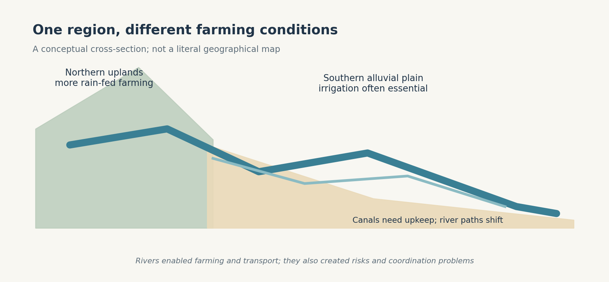

<em>Mesopotamia</em> is a Greek-derived name conventionally translated as the land between rivers. The two major rivers are the Tigris and Euphrates. Today their valleys run through parts of Turkey, Syria, and Iraq; the historical region's connections reached much farther. Northern Mesopotamia had more opportunities for rain-fed agriculture in some areas. Farther south, on the broad alluvial plain, rainfall was usually too unreliable for extensive farming without carefully managed water. People made use of river channels, wetlands, seasonal floods, canals, and fields near the changing waterways. \[<a href="/011-mesopotamia-and-the-first-states/sources/#source-3" class="cite">3</a>\]

Calling the plain 'fertile' can create an illusion. The soil was productive under suitable conditions, but a field cannot grow barley merely because a river exists somewhere nearby. Water has to arrive at the right place and time; a canal can fill with sediment; a flood can arrive unpredictably; a channel can shift; salt can accumulate under some irrigation regimes. A community that grows grain on this plain needs practical knowledge of gradients, earthworks, seasons, storage, and disputes over access. Geography created possibilities, not an instruction to invent kings.

The rivers were also roads. Boats could carry bulky grain, reeds, timber, and other goods more economically along navigable waterways than people could haul them overland. Marshes supplied fish and reeds; clay supplied material for bricks, vessels, and writing tablets. But high-quality building stone, major timber supplies, and many metals were limited in the south. Southern settlements therefore participated in far-reaching exchange with highland, coastal, and neighboring regions. Trade was not a luxury introduced after civilization became rich: it helped connect the society as it grew.

Locate Mesopotamia mentally. To the west lie the Levant and Mediterranean; northward rise Anatolian and northern Mesopotamian landscapes; eastward are the Zagros Mountains and Iranian plateau; southeast lie the Gulf and routes toward Oman and beyond. This is not a story of a sealed valley inventing everything alone. It is a regional story set within broader exchanges of crops, crafts, ideas, and people.

<figure class="figure" id="figure-11-1">

<figcaption>Figure 11.1. Schematic contrasts within Mesopotamia: waterways made southern irrigation possible but did not remove the need to manage water. <a class="figure-anchor" href="#figure-11-1" aria-label="Link to this figure">#</a></figcaption>
</figure>
