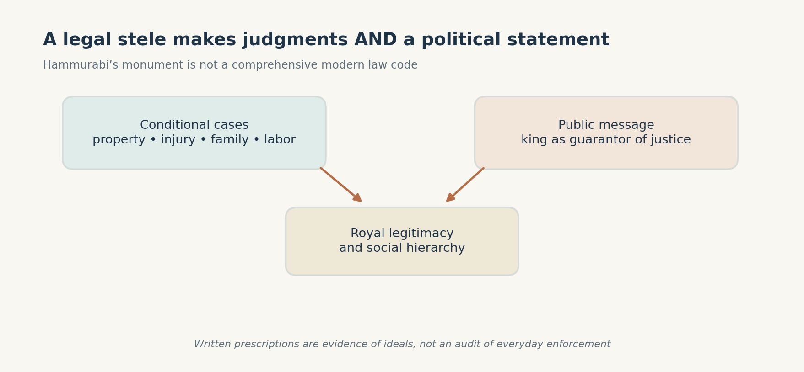

The early second millennium BCE saw competing dynasties and a changing political landscape. The city of Babylon rose to prominence, especially under Hammurabi, who reigned in the eighteenth century BCE. One of the best-known monuments of the ancient Near East is the tall inscribed stele associated with him, now in the Louvre. It presents a collection of legal judgments and principles framed by royal claims to justice and divine authority. \[<a href="/011-mesopotamia-and-the-first-states/sources/#source-16" class="cite">16</a>\]\[<a href="/011-mesopotamia-and-the-first-states/sources/#source-17" class="cite">17</a>\]

Calling it the <em>Code of Hammurabi</em> is conventional, but it can give a misleading modern impression. The Louvre explains that it is not a comprehensive legal code in the contemporary sense; its surviving provisions present specific cases dealing with property, trade, family, labor, violence, liability and status. There is also a political message: the king positions himself as one who protects justice. \[<a href="/011-mesopotamia-and-the-first-states/sources/#source-16" class="cite">16</a>\]

The provisions reveal sharp social distinctions. Different people could receive different legal treatment according to status, sex, property relationships, and the particular offense. Some judgments appear harsh to contemporary readers. Others illustrate concerns familiar today—contracts, responsibility for damages, and the need to resolve disputes. An ancient legal collection is evidence of ideals, classifications, and claims, not proof that every rule was enforced exactly as written in every village.

The black stele has a history of its own. It was later carried to Susa, in present-day Iran, and rediscovered there in the early twentieth century. Its location reminds us that objects move through conquest, collection, and archaeology; the place of discovery is not always the place of creation. This is exactly the source-critical lesson we practiced in Chapter 4.

<figure class="figure" id="figure-11-8">

<figcaption>Figure 11.8. Hammurabi’s stele combines conditional cases and a public ideology of legitimate kingship. <a class="figure-anchor" href="#figure-11-8" aria-label="Link to this figure">#</a></figcaption>
</figure>
