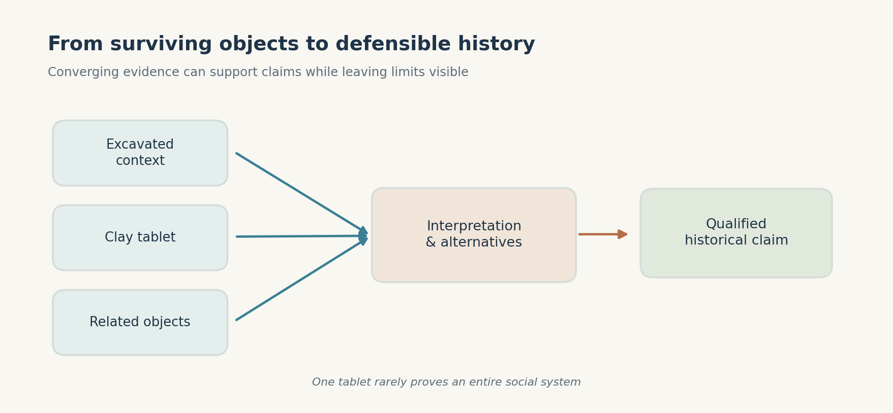

Imagine an excavator finds a small tablet in a layer associated with a building near Uruk. It contains numerals and signs for commodities. A tempting headline reads, 'Ancient tax records prove a king controlled all agriculture.' What does the tablet actually tell us? First, it appears to record quantities and categories. Its layer offers a date range, subject to disturbance and dating methods. Its script can be compared with other tablets. But the existence of accounting does not prove that every payment was a tax, that a king personally supervised it, or that all households were under one central plan.

Now add independent observations. Seals appear near storage areas; several buildings show signs of organized production; later tablets mention named officials. A picture of institutional administration begins to form. Yet we still need to distinguish the period of each source, the place where it was found, and the scope of the institution it represents. Confidence should rise with converging evidence, not with the loudness of the narrative.

A strong Mesopotamian history also considers the problem of preservation. Clay sometimes survives wonderfully; wood, textiles and most everyday speech usually do not. A fire can accidentally bake tablets and preserve a temporary office record for millennia. An archive's accidental survival may exaggerate one institution's importance relative to others whose records were lost. We cannot assume that what survives was what mattered most to the people living there.

This method is the bridge from Chapter 4 to all the history chapters ahead. We are not collecting legends of great civilizations. We are reconstructing explanations from incomplete traces. If you can ask how an archaeological claim was established, which sources support it, and what alternative accounts remain plausible, you are beginning to think like a historian.

<figure class="figure" id="figure-11-9">

<figcaption>Figure 11.9. Historical interpretation draws on context, documents and objects; one object rarely proves a whole political system. <a class="figure-anchor" href="#figure-11-9" aria-label="Link to this figure">#</a></figcaption>
</figure>
