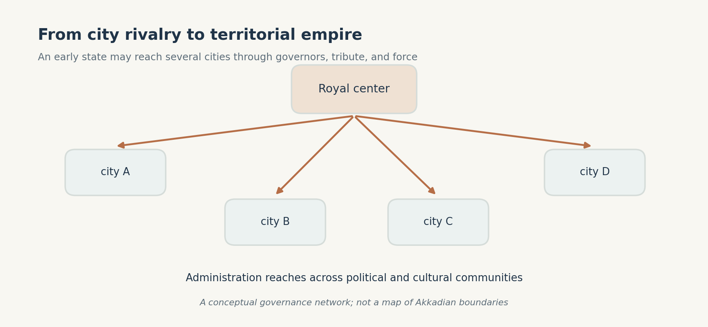

Around the twenty-fourth century BCE, the political landscape changed dramatically. Sargon of Akkad and the rulers who followed him brought many cities under a wider territorial government through conquest. The Akkadian dynasty is commonly identified as one of the earliest large territorial empires, even if earlier states had exercised extensive regional power. The political center called Agade or Akkad has not been securely located. \[<a href="/011-mesopotamia-and-the-first-states/sources/#source-10" class="cite">10</a>\]\[<a href="/011-mesopotamia-and-the-first-states/sources/#source-13" class="cite">13</a>\]

Empire is different from a collection of allied city-states. A conquering ruler can demand tribute, appoint representatives, impose obligations, and attempt to regulate territories inhabited by people with differing local identities. Such arrangements may expand communication and trade, but they also increase costs, create resistance and demand more administration. Conquest alone cannot guarantee stability. Soldiers require provisions; governors can act independently; local elites may cooperate or rebel; distant communities may experience central authority as both opportunity and oppression.

Later traditions credited Sargon with a dramatic rise to power. Kings were often celebrated through stories that strengthened their legitimacy. Historians compare such tales with inscriptions, administrative evidence and archaeology. The dynasty's military achievement is significant, but legends about its founder should not be repeated as unmediated biography. We can know that an empire emerged without knowing every detail of the ruler's childhood or motives.

Akkadian, a Semitic language, became important in imperial and administrative contexts; Sumerian cultural and scribal traditions did not simply disappear. The interaction of languages and institutions is one of empire's central features. Conquerors govern through existing local networks even when they change the balance of power. The Akkadian period is also associated with notable royal art, including imagery that elevates kingship. Its history reminds us that a large realm may be administratively sophisticated and politically vulnerable at the same time.

<figure class="figure" id="figure-11-7">

<figcaption>Figure 11.7. The administration of a territorial empire requires relationships between royal authority and numerous local centers. <a class="figure-anchor" href="#figure-11-7" aria-label="Link to this figure">#</a></figcaption>
</figure>
