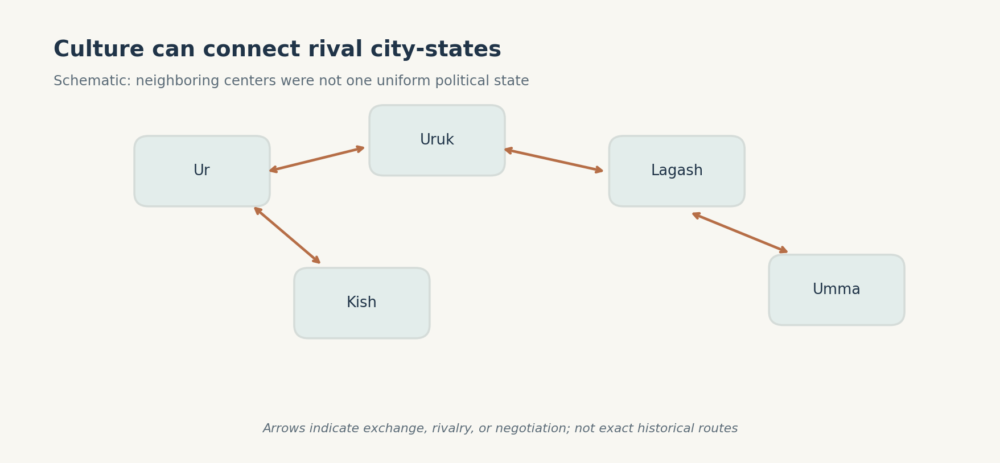

In the Early Dynastic period, roughly 2900–2350 BCE, southern Mesopotamia contained rival city-states. Uruk, Ur, Lagash, Umma, Kish and other centers were not departments of a single modern country called Sumer. They had their own political histories, changing alliances, rulers, and territorial interests. The Sumerian language and associated cultural traditions did not necessarily create one political community. \[<a href="/011-mesopotamia-and-the-first-states/sources/#source-4" class="cite">4</a>\]\[<a href="/011-mesopotamia-and-the-first-states/sources/#source-10" class="cite">10</a>\]

That distinction should sound familiar from our earlier lesson on nations and states. A shared cultural or linguistic environment does not guarantee unified government. Rival cities can honor overlapping religious traditions, exchange goods, adopt similar practices, and still fight over land and precedence. Some settlements dominated their neighbors temporarily. Others lost influence. Power could be local, regional, or ambitious enough to reach far beyond one city.

The term <em>city-state</em> is useful but imperfect: ancient territorial control may have been negotiated, contested, and shifting. There was no uniform national border drawn across a modern political atlas. A city's authority might depend on canals, fields, tributary settlements, alliances, and the military capacity of its rulers. A claim on an inscription tells us how an authority wanted a contested landscape to be understood; it does not necessarily establish that everyone accepted the claim.

As city-states fought, they also learned from one another. Rivalry could motivate monuments, defensive work, new titles, and claims of divine support. War could move captives and goods. Victory could elevate a ruler; defeat could unravel an administration. The most useful question is not 'Which city was first?' but 'How did competition alter the institutions that organized everyday life?'

<figure class="figure" id="figure-11-6">

<figcaption>Figure 11.6. Sumerian-speaking city-states could share cultural practices while retaining independent political authority. <a class="figure-anchor" href="#figure-11-6" aria-label="Link to this figure">#</a></figcaption>
</figure>
