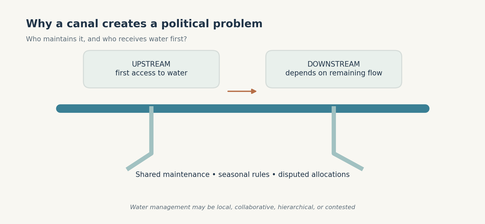

Imagine two farming communities sharing a canal. The upstream community can take water first. The downstream community fears that excessive diversion will leave its crops dry. Both need the canal cleared after silt accumulates, but neither wants to supply most of the work if the other will benefit equally. A drought raises the stakes; a bumper harvest may reduce the immediate pressure. These are recurring coordination problems that could encourage negotiated rules, communal work, administrative oversight, or—in some circumstances—coercive power.

This example is a model, not a transcript from an excavated canal court. It explains why an agricultural landscape generates demands for institutions. A canal is infrastructure: it requires construction, maintenance, timing, and sometimes sanctions against people who breach an agreement. It also creates dependence. The same channel that increases yields can place farmers in conflict if one household's benefit reduces another's water supply.

Older scholarship sometimes treated irrigation as the single cause of centralized states: big irrigation works supposedly required despotic rulers. That is too sweeping. Some irrigation systems are locally organized; some states depend more on warfare, ideology, exchange, or tribute; and waterways can be managed without a single ruler. Archaeologists test relationships between canals, settlement patterns, and political institutions rather than assuming that one technological need determined an entire political system.

A useful systems diagram would show two paths. Water management can increase harvest reliability, encouraging settlement and investment; at the same time, concentrated control over gates, labor, and records may create unequal bargaining power. Water can support cooperation and conflict. The institutional question is not just how much grain is produced, but <strong>who decides who receives the water, who must maintain the canal, and who bears the cost when it fails</strong>.

<figure class="figure" id="figure-11-3">

<figcaption>Figure 11.3. Two farming communities share the benefits and risks of one irrigation channel. Water rights require coordination. <a class="figure-anchor" href="#figure-11-3" aria-label="Link to this figure">#</a></figcaption>
</figure>
