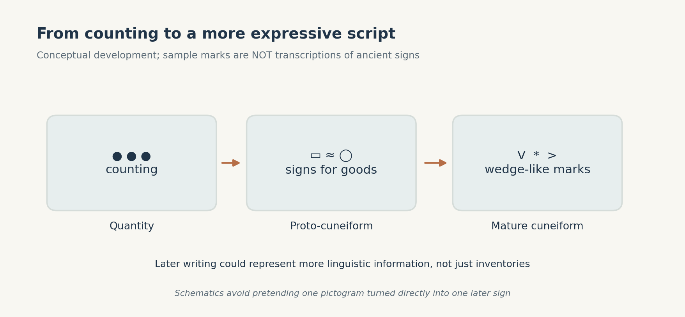

Among the most consequential finds from late-fourth-millennium Uruk are tablets containing numerals and signs for commodities and administrative categories. The earliest stages of this script are usually described as <em>proto-cuneiform</em>. Their marks do not yet function in the same way as fully developed writing capable of expressing any spoken statement. Over time, signs became increasingly abstract and the system was adapted to represent sounds and the structures of spoken languages. This development did not happen overnight. \[<a href="/011-mesopotamia-and-the-first-states/sources/#source-1" class="cite">1</a>\]\[<a href="/011-mesopotamia-and-the-first-states/sources/#source-2" class="cite">2</a>\]

Early tablets might identify quantities of grain or other goods. They tell us about management and accounting before they tell us much about personal emotion. Some signs initially represented objects or concepts; later signs could also represent sounds, enabling names, grammatical forms, and literary expression. In mature cuneiform, wedge-shaped marks were pressed with a stylus into clay. The same writing technology eventually recorded more than one language, especially Sumerian and Akkadian, which belong to different linguistic families. \[<a href="/011-mesopotamia-and-the-first-states/sources/#source-2" class="cite">2</a>\]\[<a href="/011-mesopotamia-and-the-first-states/sources/#source-7" class="cite">7</a>\]

It is tempting to say the Sumerians 'invented writing' and stop. Two corrections are necessary. First, the archaeological sequence remains incomplete, and scholars debate the relationships among different accounting and marking systems. Second, the Egyptian writing system emerged around the same broad period, and processes of influence and independent development remain matters of scholarship. The meaningful achievement is the invention and elaboration of a durable means of representing information in ways that could travel beyond direct human memory.

Do not imagine literacy suddenly spreading to everyone. In the early stages, writing was specialized, and training required time. For many people, the city was still primarily experienced through speech, ritual, labor, goods, and personal relationships. Yet a small literate class could preserve transactions, teachings, political proclamations and prayers in ways unavailable to prior generations. The greater paradox is that records written to administer today's grain became the evidence by which we study a society thousands of years later.

<figure class="figure" id="figure-11-5">

<figcaption>Figure 11.5. Conceptual development from quantities and commodity signs toward a script able to record language. <a class="figure-anchor" href="#figure-11-5" aria-label="Link to this figure">#</a></figcaption>
</figure>
