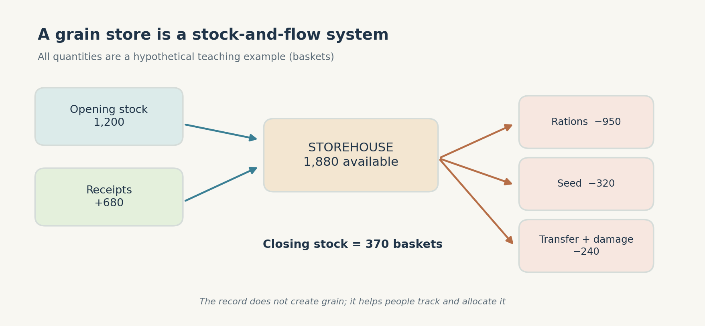

Consider a teaching example based on the kinds of accounting challenges that appear in early administrative texts. A storehouse begins the season with 1,200 baskets of grain. It receives 680 more. The institution distributes 950 as rations, sets aside 320 for seed, transfers 180 to another settlement, and loses 60 to damage. The closing stock is 1,200 + 680 - 950 - 320 - 180 - 60 = <strong>370 baskets</strong>. No ancient tablet from Uruk is being translated here; these numbers are modern and hypothetical.

The arithmetic is simple. The social consequences are not. Suppose a clerk records the transfer but not the damaged grain. An administrator thinks 430 baskets remain, not 370, and promises rations that the storehouse cannot provide. A missing record can create an apparent shortage. A false record can conceal diversion. A consistent unit of measurement and a recognized person or seal responsible for delivery become valuable because an agreement spanning many people needs to be verifiable.

In later Mesopotamian systems, complex metrology and accounting developed, with different measuring conventions for goods and transactions. Do not assume that one modern kilogram or one modern basket equals an ancient standardized unit. Instead remember the conceptual leap: people were organizing flows of resources through time. Chapter 7's distinction between <em>stocks</em> and <em>flows</em> is suddenly visible in the ancient world: a harvest raises the stock, rations and transfers lower it, and a record allows institutions to compare expectation with reality.

We should avoid turning this into a romantic claim that accounting created civilization. People managed obligations without writing for thousands of years, and economic records cannot reveal every form of social trust or exchange. But durable administration allowed certain institutions to become larger, more complex, and more persistent. A humble entry about grain belongs in the same historical conversation as a temple, a ruler, or a city's walls.

<figure class="figure" id="figure-11-4">

<figcaption>Figure 11.4. Worked hypothetical accounting example: a closing stock is changed by receipts and outflows. <a class="figure-anchor" href="#figure-11-4" aria-label="Link to this figure">#</a></figcaption>
</figure>
