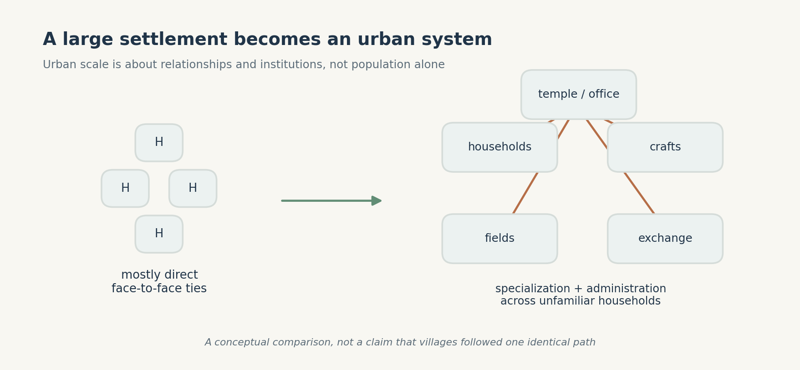

By around 3200 BCE, Uruk was an extraordinary settlement in southern Mesopotamia. Its monumental architecture, extensive built environment, specialized production, and administrative material identify it as an early large city. Accounts of its exact population differ because archaeology cannot count every resident; confident single-number estimates should be treated as approximations, not ancient census results. The Metropolitan Museum describes it as among the world's largest settlements of the period. \[<a href="/011-mesopotamia-and-the-first-states/sources/#source-1" class="cite">1</a>\]\[<a href="/011-mesopotamia-and-the-first-states/sources/#source-5" class="cite">5</a>\]

What makes Uruk worth a whole chapter in the history of cities is not merely its size. The settlement contained impressive public and ritual buildings, large-scale wall decoration, production and storage practices, and evidence for organized allocation of resources. Clay cones set into plaster could form patterns on prominent walls. Mass-produced vessels and administrative seals testify to standardized practices. Most visitors to ancient Uruk were probably not marveling at a theory of civilization; they were navigating everyday demands in a place where large institutions and unfamiliar people existed side by side.

A large population changes the geometry of social life. In a village of several dozen people, many exchanges may be understood through direct acquaintance, kinship, reputation, and face-to-face negotiation. In a city, you might receive food from a distribution system, buy a tool from a craftsperson you do not know, obey a gatekeeper, work on a construction project, and become involved in a dispute with someone whose family is unfamiliar. The city depends on rules, expectations, and records that reach beyond a small community.

But population size alone does not explain everything. Archaeologists also study <em>institutional density</em>: the concentration of activities such as administration, religious practice, craft specialization, and coordination of labor. Uruk's development and its interactions with other settlements therefore matter more than a competition for 'world's first city' that cannot be settled precisely. Other early urban centers and complex settlements existed, and definitions of a city differ. \[<a href="/011-mesopotamia-and-the-first-states/sources/#source-5" class="cite">5</a>\]

<figure class="figure" id="figure-11-2">

<figcaption>Figure 11.2. A city involves specialized activities and institutions connecting households beyond immediate face-to-face relationships. <a class="figure-anchor" href="#figure-11-2" aria-label="Link to this figure">#</a></figcaption>
</figure>
