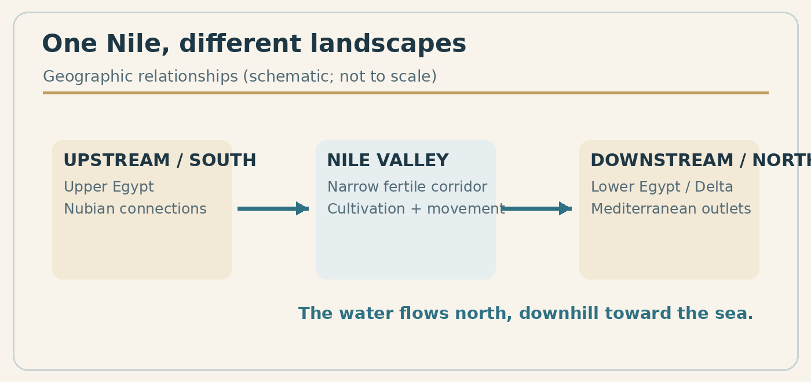

The Nile runs north from its upstream catchments toward the Mediterranean Sea. That simple orientation unsettles many learners because maps often place north at the top and encourage us to imagine movement from top to bottom. Ancient Egyptians called the southern valley <em>Upper Egypt</em> and the northern Delta <em>Lower Egypt</em>. The names refer to the river's upstream and downstream geography, not to political rank. Around the Mediterranean-facing Delta the river divided into distributaries across a wide alluvial landscape; farther south much of the cultivated zone occupied a relatively narrow ribbon beside the water. \[<a href="/012-ancient-egypt-and-the-nile/sources/#source-3" class="cite">3</a>\]

The valley was bordered by deserts, but 'desert' does not mean an empty wall. Routes across the Eastern Desert linked the Nile to the Red Sea and mineral areas. Western oases connected settlements to alternative paths and scarce water sources. To the south, the cataracts—stretches of rocky or turbulent river—complicated navigation but did not cut Egypt off from Nubia. The Nile was therefore both a transportation corridor and one line within a much larger network of environmental opportunities and political relationships.

The annual flood was the product of rainfall patterns farther upstream, especially the seasonal rains that fed the Blue Nile and Atbara in northeastern Africa. Floodwater carried sediment and helped sustain agricultural land in Egypt, where rainfall was sparse across much of the valley. But the flood was not a guaranteed gift of predictable size. A very low flood could damage production; a destructive high flood could wash away property and complicate cultivation. Water also required local decisions: which fields received it, when basins were opened or drained, who maintained dikes, and how grain was stored. An agricultural landscape is not simply found; it is managed. \[<a href="/012-ancient-egypt-and-the-nile/sources/#source-3" class="cite">3</a>\]\[<a href="/012-ancient-egypt-and-the-nile/sources/#source-4" class="cite">4</a>\]

<figure class="figure" id="figure-12-1">

<figcaption>Figure 12.1. The river connects upstream Upper Egypt with downstream Lower Egypt and the Delta; routes and environment are schematic. <a class="figure-anchor" href="#figure-12-1" aria-label="Link to this figure">#</a></figcaption>
</figure>

A useful mental model is a coupled system. Upstream climate affects flood behavior. Flood behavior shapes soil moisture and available cultivation. Agricultural output influences food stores, taxation and political stability. Those institutions can in turn build infrastructure, accumulate reserves, or demand more from the countryside. The same flood could be interpreted by a priest as a sign within cosmic order, by a farmer as a practical problem, and by an official as a basis for estimating grain receipts. None of these perspectives cancels the others; each answers a different question.
