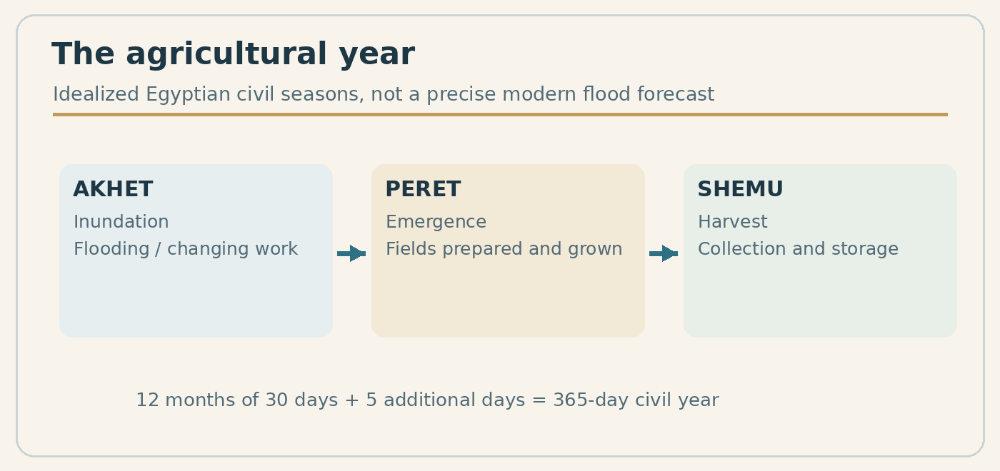

The classical Egyptian civil calendar divided the year into three four-month seasons, with five additional days: <em>Akhet</em>, the inundation; <em>Peret</em>, the emergence or growing season; and <em>Shemu</em>, the harvest. Its 365-day structure was convenient for administration, although without leap-day correction its dates drifted slowly relative to the solar year. Egyptians also observed astronomical phenomena, including the heliacal rising of Sirius, but the calendar was not simply a perfect flood clock. The river and the human calendar were related without being mechanically identical. \[<a href="/012-ancient-egypt-and-the-nile/sources/#source-5" class="cite">5</a>\]

Imagine a fictional farm family in a village on the river. When floodwater occupies fields, labor opportunities and household tasks change; when it recedes, land must be prepared and sown; later a harvest must be processed and stored. This sketch is representative rather than a diary from one identified household. Actual work varied across centuries, regions, field types and social positions. Some people cultivated grain; others maintained canals, transported goods, worked in temples, cared for animals, wove textiles or made tools. The state's tax demands were one part of an economy in which household arrangements, local obligations and institutional estates also mattered.

Here is a simplified calculation to expose the institutional problem. Suppose a hypothetical settlement expects 1,000 sacks of grain. After a low flood, it harvests 720. It needs 400 for household food, 120 for seed and 100 for local obligations; that leaves only 100 sacks as a buffer, before losses or further demands. If an official insists on a tax assessment based on the original expected harvest, the apparent surplus vanishes. This is a teaching scenario, not an ancient Egyptian account. It shows why measuring agricultural production, protecting seed grain, and responding to shortfalls are both economic and political questions.

<figure class="figure" id="figure-12-2">

<figcaption>Figure 12.2. The three civil seasons organized time around the flood, growth and harvest; historical timing varied. <a class="figure-anchor" href="#figure-12-2" aria-label="Link to this figure">#</a></figcaption>
</figure>

It is tempting to imagine a single master plan directing every canal from the royal palace. Archaeological and historical evidence supports substantial organization of water and agriculture, but the precise scale of central hydraulic control changed over time and location. Villages, estates, local officials and rulers could all take part. <strong>The ability to coordinate a river valley helps explain state power; it does not prove that river management automatically created an omnipotent state.</strong>
