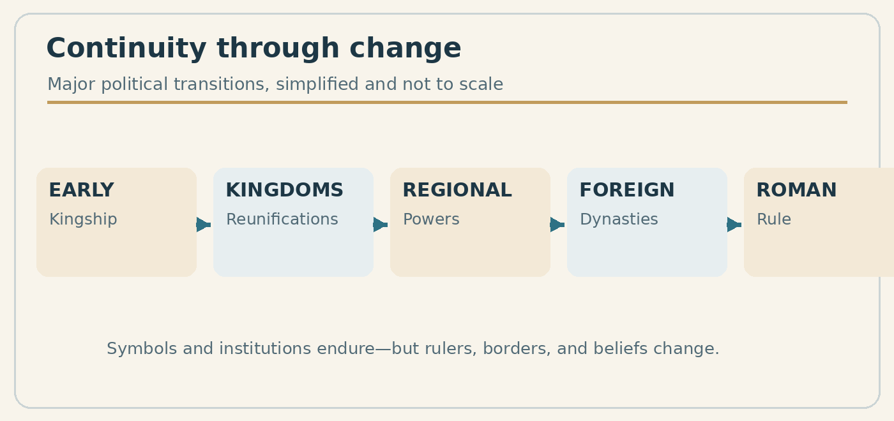

Political authority became more decentralized after the New Kingdom. Different dynastic groups and regional powers exercised influence during the Third Intermediate Period. Egypt remained culturally productive, economically active and historically connected even when a single royal court did not dominate the whole valley. That is an important correction to stories in which historical importance ends whenever a strong pharaoh disappears. \[<a href="/012-ancient-egypt-and-the-nile/sources/#source-18" class="cite">18</a>\]

In the first millennium BCE, Kushite rulers built a kingdom whose leaders came to rule Egypt, establishing the Twenty-fifth Dynasty. Egypt later confronted Assyrian power, experienced new local dynasties and periods of Persian rule. These developments were not identical episodes of foreign conquest; each involved different political arrangements and degrees of cultural interaction. Native Egyptian institutions and religious practices persisted and adapted under multiple ruling houses. \[<a href="/012-ancient-egypt-and-the-nile/sources/#source-18" class="cite">18</a>\]\[<a href="/012-ancient-egypt-and-the-nile/sources/#source-22" class="cite">22</a>\]

Alexander of Macedon entered Egypt in 332 BCE, and after his death the Ptolemaic dynasty governed a Hellenistic kingdom centered on Egypt. Its last ruler, Cleopatra VII, operated in a Roman-dominated diplomatic environment. When Roman forces defeated her alliance with Mark Antony, Egypt came under Roman rule in 30 BCE. That date marks a major political transition, not the instantaneous disappearance of Egyptian languages, people or sacred traditions. \[<a href="/012-ancient-egypt-and-the-nile/sources/#source-22" class="cite">22</a>\]

<figure class="figure" id="figure-12-11">

<figcaption>Figure 12.11. Political history shows recurrent fragmentation, new ruling houses and institutional continuities. <a class="figure-anchor" href="#figure-12-11" aria-label="Link to this figure">#</a></figcaption>
</figure>

The phrase 'ancient Egypt lasted three thousand years' is helpful as a sense of scale but potentially misleading. Historians are not describing one unchanging political institution, identical national borders, or a single continuous population behaving as one. Over that span there were repeated reconstructions of authority, demographic changes, foreign contacts, religious developments and linguistic transitions. Continuity itself was created and interpreted by people who reached backward to earlier precedents.
