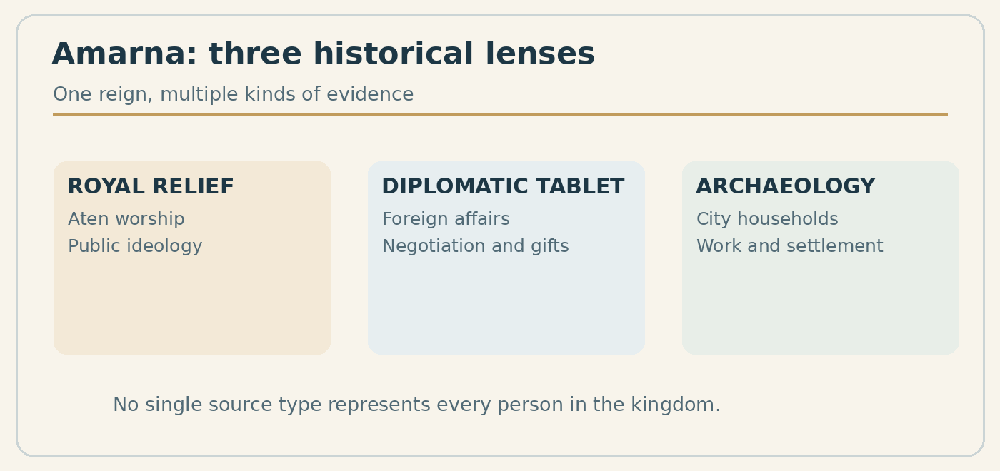

Another ruler of Dynasty 18, Amenhotep IV—later Akhenaten—promoted an unusually concentrated royal cult focused on the Aten, the sun disk. He established a new royal residence and ceremonial center at Akhetaten, modern Amarna, and adopted distinctive artistic and religious practices. The dramatic differences in surviving images have made his reign famous, but some older accounts exaggerate how completely the country abandoned previous religious life or how uniformly the new cult was embraced. \[<a href="/012-ancient-egypt-and-the-nile/sources/#source-16" class="cite">16</a>\]

The reform was a transformation of elite religious policy, monumental practice and the court's public image. Did it amount to monotheism in the precise sense used for much later religious traditions? Scholars disagree over terminology and how to interpret the period's representations of other gods. <em>Atenism</em> is often a safer label than asserting that one modern category fits the evidence completely. What can be established more confidently is the extraordinary royal focus on the Aten and the changes imposed on public worship and imagery. \[<a href="/012-ancient-egypt-and-the-nile/sources/#source-16" class="cite">16</a>\]

<figure class="figure" id="figure-12-8">

<figcaption>Figure 12.8. Royal images, diplomatic tablets and city archaeology answer different questions about the Amarna period. <a class="figure-anchor" href="#figure-12-8" aria-label="Link to this figure">#</a></figcaption>
</figure>

The Amarna letters offer a parallel perspective. They are not theological manifestos; many concern the practical problems of communication and geopolitical relationships. Their existence prevents us from pretending that religious reform replaced the business of government. After Akhenaten, the court moved away from the Amarna experiment and restored many previously established cults. Tutankhamun is a familiar name partly because of the extraordinary preservation of his tomb, not because his reign was necessarily more politically influential than those of many less famous rulers.

A well-preserved tomb can distort historical memory. A king whose burial escaped major robbery may become world-famous, while an institution that organized the lives of thousands leaves fewer spectacular objects. Historical importance and archaeological visibility are different variables. The distinction is central to the whole Knowledge Kingdom project.
