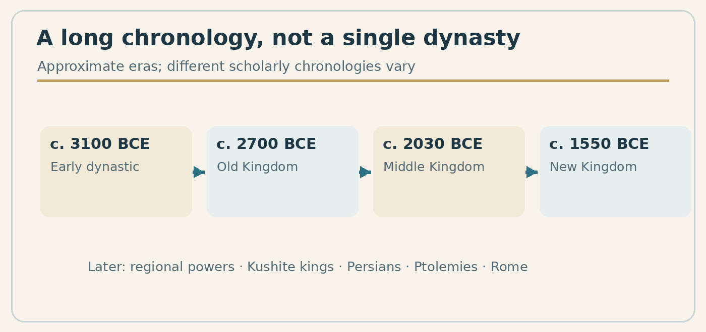

A celebrated slate object, the Narmer Palette, depicts a ruler wearing crowns associated with Upper and Lower Egypt in scenes of domination and order. It is evidence that early royal authority was visually represented through the language of victory and the two lands. It is not a camera recording of a single decisive battle on a known afternoon. Historians debate how to connect the object to the process of political unification, its ceremonial setting and the identities preserved in later king lists. \[<a href="/012-ancient-egypt-and-the-nile/sources/#source-6" class="cite">6</a>\]\[<a href="/012-ancient-egypt-and-the-nile/sources/#source-7" class="cite">7</a>\]

Later tradition credits an early unifying king called Menes. Modern historical reconstructions often discuss Narmer and Aha in relation to that tradition, but the relationship among names, titles and later accounts is not absolutely settled. The familiar date <em>around 3100 BCE</em> is a useful orientation, not a day printed on a modern birth certificate. Egyptian chronology is assembled through archaeological layers, contemporary inscriptions, king lists, astronomical evidence and comparisons with other regions. Different standard chronologies may differ by decades, particularly in earlier periods. \[<a href="/012-ancient-egypt-and-the-nile/sources/#source-7" class="cite">7</a>\]

<figure class="figure" id="figure-12-3">

<figcaption>Figure 12.3. Approximate early phases of Egyptian history; these are chronological guideposts, not exact boundaries. <a class="figure-anchor" href="#figure-12-3" aria-label="Link to this figure">#</a></figcaption>
</figure>

The double crown is a powerful symbol: sovereignty over north and south presented as an ideal whole. Yet images of unity are also part of the process by which unity is claimed. A later king might emphasize the continuing tradition precisely because elites, provinces, towns and regional interests needed to be held together. Historians should ask which authority commissioned an image, where it appeared, and what alternative perspectives are missing.
