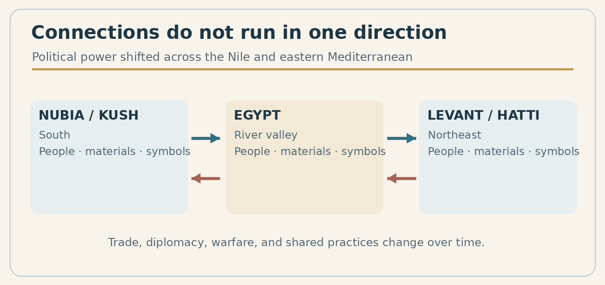

The Nile connected Egypt to the regions commonly called Nubia, including the territories of present-day southern Egypt and northern Sudan, but the relationship was never a simple story of Egypt 'civilizing' an otherwise empty south. Nubian communities developed distinct political traditions, expertise, trade networks and royal cultures. The kingdom centered on Kerma was a formidable regional power long before the later Napatan and Meroitic phases associated with Kush. Egyptian rulers at different times traded with, conquered, fought and learned from Nubian societies. \[<a href="/012-ancient-egypt-and-the-nile/sources/#source-11" class="cite">11</a>\]

Egyptian inscriptions often used familiar categories of foreignness and subordination, especially when kings wished to advertise dominance. Such texts are evidence of Egyptian royal ideology, not neutral ethnographies of Nubian life. Archaeology from Nubian settlements, cemeteries and monuments shows political and cultural complexity beyond what hostile inscriptions record. During the New Kingdom, Egypt exercised extensive control over portions of Nubia; later the balance of power reversed. Kings from Kush ruled Egypt as its Twenty-fifth Dynasty in the first millennium BCE. \[<a href="/012-ancient-egypt-and-the-nile/sources/#source-11" class="cite">11</a>\]\[<a href="/012-ancient-egypt-and-the-nile/sources/#source-18" class="cite">18</a>\]

<figure class="figure" id="figure-12-9">

<figcaption>Figure 12.9. Ancient Egypt participated in overlapping African and western Asian networks of influence and exchange. <a class="figure-anchor" href="#figure-12-9" aria-label="Link to this figure">#</a></figcaption>
</figure>

That reversal matters intellectually. It overturns the imagined permanence of an Egyptian center commanding an African periphery. Nubian elites could adopt elements of Egyptian iconography, transform them and make them part of their own political tradition. Cultural borrowing did not necessarily mean political dependence, and shared symbols did not erase distinct identities. The Nile carried goods, people and religious forms in more than one direction.

For a world-history book, Egypt belongs within African history as well as Mediterranean and western Asian history. Those are complementary geographical relationships, not competing labels. Treating Egypt only as a European museum spectacle leaves out the societies and landscapes with which Egyptians interacted throughout their long history.
