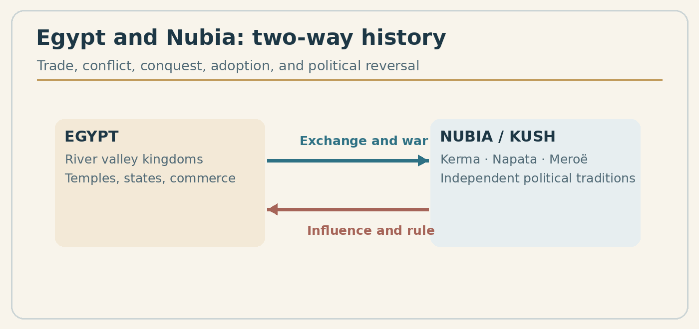

The reunification associated with Mentuhotep II marked the beginning of the Middle Kingdom around 2030 BCE in one widely used chronology. Later rulers, including those of Dynasty 12, invested in administrative structures, royal construction, literature, military defense and trade. Thebes became a major religious and political center; Memphis and other sites remained important. Egypt was not just 'restored' to an unchanged Old Kingdom template. The political imagination and artistic forms of the Middle Kingdom had distinctive features of their own. \[<a href="/012-ancient-egypt-and-the-nile/sources/#source-10" class="cite">10</a>\]

Middle Kingdom literature includes works that stage questions about loyalty, uncertainty, elite conduct and the instability of fortune. We should not automatically interpret literary characters as the exact beliefs of their authors or a statistically representative view of Egyptian society. But these texts make it harder to reduce the period to a king list. Royal and private monuments also reveal different ways of representing authority and piety.

Southward relations with Nubia were central. Egyptian rulers established strongholds and controlled or sought control over routes and territory near the Second Cataract. Across the border, complex Nubian societies developed their own institutions, including the important polity associated with Kerma. Egyptian documents often represented neighboring peoples through political stereotypes; Nubian archaeology corrects the illusion that the region existed only in relation to Egypt. \[<a href="/012-ancient-egypt-and-the-nile/sources/#source-11" class="cite">11</a>\]

<figure class="figure" id="figure-12-7">

<figcaption>Figure 12.7. Egyptian and Nubian histories involved changing power, exchange, conquest and cultural adaptation. <a class="figure-anchor" href="#figure-12-7" aria-label="Link to this figure">#</a></figcaption>
</figure>

The Middle Kingdom eventually gave way to another complex period of overlapping authorities. In the north, rulers often called the Hyksos held power in parts of Egypt during the Second Intermediate Period; southern rulers maintained competing centers. The Hyksos should not be imagined as an entire civilization that arrived one morning and replaced everything Egyptian. Their rise involved people and traditions connected to western Asia and the Delta, and interpretation has changed with new archaeological evidence. After prolonged conflict, rulers from Thebes established a new phase of national unification. \[<a href="/012-ancient-egypt-and-the-nile/sources/#source-12" class="cite">12</a>\]
