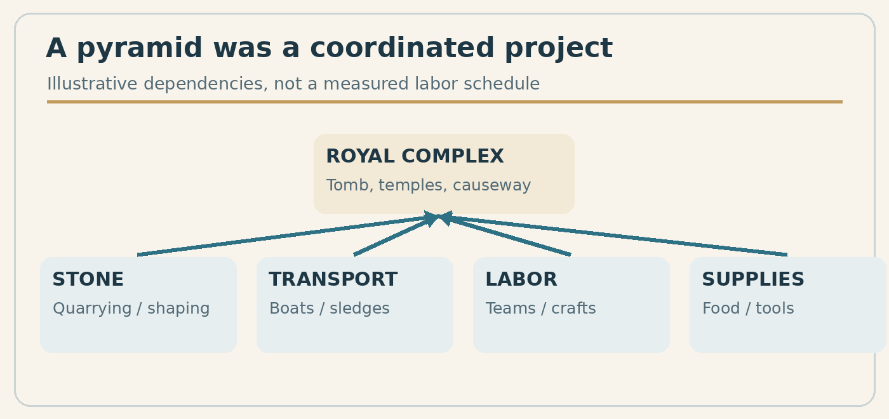

The Old Kingdom, conventionally dated to roughly the third millennium BCE and often associated with Dynasties 3–6, developed powerful forms of court culture, monumental tomb building and provincial administration. Djoser's Step Pyramid at Saqqara was an architectural experiment with profound consequences. Later fourth-dynasty kings—including Snefru, Khufu, Khafre and Menkaure—developed pyramid complexes whose scale still changes how visitors imagine the ancient world. The monumental sequence was not a simple leap from a single idea to perfected geometry. Builders experimented with forms, materials, alignments and organization. \[<a href="/012-ancient-egypt-and-the-nile/sources/#source-2" class="cite">2</a>\]\[<a href="/012-ancient-egypt-and-the-nile/sources/#source-8" class="cite">8</a>\]

A pyramid was part of a wider funerary landscape: temples, causeways, smaller tombs, ritual spaces, stores and work areas. The famous Great Pyramid was associated with Khufu. The Giza plateau also preserves evidence of cemeteries, infrastructure and workers' settlements. Monumental building involved quarrying stone, transporting it, providing food and tools, and coordinating specialized labor. Estimates of manpower and the exact methods of moving large blocks remain debated; no surviving evidence justifies the common claim that modern historians have 'no idea' how people could have built pyramids. We know important mechanisms and constraints, though details of particular ramps and construction sequences remain subjects of research. \[<a href="/012-ancient-egypt-and-the-nile/sources/#source-1" class="cite">1</a>\]\[<a href="/012-ancient-egypt-and-the-nile/sources/#source-2" class="cite">2</a>\]\[<a href="/012-ancient-egypt-and-the-nile/sources/#source-8" class="cite">8</a>\]

<figure class="figure" id="figure-12-5">

<figcaption>Figure 12.5. Major monuments depended on transport, labor, food supply and logistical coordination as well as design. <a class="figure-anchor" href="#figure-12-5" aria-label="Link to this figure">#</a></figcaption>
</figure>

Were the pyramids built by enslaved people? The simplistic picture of enormous anonymous slave gangs doing all work is not supported by the archaeological picture of organized labor communities, skilled crews and state provisioning. But it would be equally careless to conclude that all labor was voluntary in the modern sense. Ancient obligations, corvée labor, dependence, status differences and episodes of coercion existed within changing institutions. We should distinguish labor organization from workers' legal freedom, and avoid imposing a single labor label on every worker and century.

A stone monument teaches us about capacity and beliefs. It does not establish that every household was prosperous. That is why the remains of bread production, pottery, food bones and dwellings are so valuable. They draw the camera away from the king. Ordinary people were not merely the anonymous 'background' of an architectural achievement; their work and decisions were its necessary conditions.
