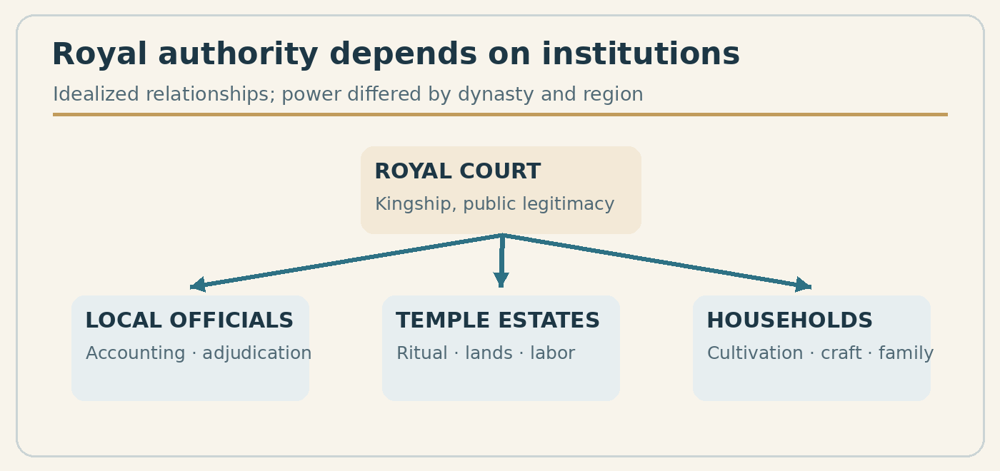

A pharaoh was the central figure of Egyptian kingship, but royal power operated through households, officials, temples, military units, estates and local communities. The title translated as 'pharaoh' grew from a term meaning the 'great house' and came into more regular use for the sovereign later in Egyptian history. Using it for very early rulers is a convenient modern convention, not proof that everyone in the first dynasty used the word in the same way. \[<a href="/012-ancient-egypt-and-the-nile/sources/#source-7" class="cite">7</a>\]

Egyptian royal ideology made the king responsible for protecting <em>maat</em>: an ideal of truth, justice, right order and proper balance. The concept was religious and political; it did not mean that every decision made by a king was fair. Royal texts often picture enemies subdued, offerings maintained, temples built and a harmonious land restored. These conventions expressed aspirations and claims of legitimacy. Administrators faced mundane constraints: obtaining grain, accounting for labor, sending instructions along the Nile, managing officials, resolving land disputes and communicating across distances.

Consider the <em>vizier</em>, a senior administrative figure whose responsibilities changed across dynasties. In inscriptions and office lists, high officials may boast of judging fairly, collecting dues, supervising works or serving the king. Such titles show how authority was represented and delegated. They do not prove that the population experienced an impartial bureaucracy. A ruler may need officials precisely because the ruler cannot personally control every village. Officials can extend royal authority and simultaneously become powerful actors in their own right.

<figure class="figure" id="figure-12-4">

<figcaption>Figure 12.4. Royal administration worked through officials, temples, households and relationships that changed over time. <a class="figure-anchor" href="#figure-12-4" aria-label="Link to this figure">#</a></figcaption>
</figure>

We should also resist placing Egypt neatly into a modern political category. It had coercion, offices, law-like practices and ideological claims, but there was no single written constitution resembling contemporary constitutional government. Nor should 'divine kingship' be treated as a timeless formula. Forms of royal divinity, succession, temple relationships and public image evolved across more than two millennia.
