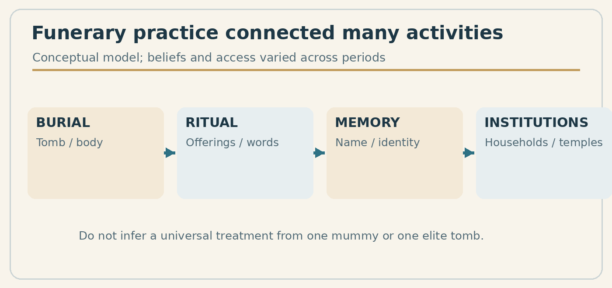

Tombs were not simply storage places for corpses. Egyptian funerary beliefs connected a person's continuing existence to bodily preservation, appropriate rituals, identity, memory and offerings. Ideas changed markedly over time and between social groups. Early elite burials, Old Kingdom pyramid complexes, Middle Kingdom coffins and later funerary papyri were not identical expressions of a fixed religion. Some practices became accessible to wider groups over time, while wealth still shaped what people could afford. \[<a href="/012-ancient-egypt-and-the-nile/sources/#source-8" class="cite">8</a>\]\[<a href="/012-ancient-egypt-and-the-nile/sources/#source-9" class="cite">9</a>\]

The Egyptian person was understood through several interrelated dimensions commonly rendered in modern discussions as <em>ka</em>, <em>ba</em> and <em>akh</em>, though translating them as three familiar modern concepts can mislead. The <em>ka</em> can be discussed in relation to life force and sustenance; <em>ba</em> in relation to mobile or distinctive aspects of a person; and <em>akh</em> in relation to an effective transformed being. Ancient texts are varied and sometimes difficult to reconcile. Their purpose was not to teach a single modern theological system with identical definitions across periods.

Mummification developed through many techniques. Removal and treatment of organs, natron drying, wrapping and coffin practices varied by period, place, means and circumstances. Ancient texts do not provide one comprehensive technical manual. Archaeologists therefore learn by examining surviving remains and comparing them carefully, without assuming that a technique observed in one mummy describes all Egyptian funerary practice. Deserts also preserved bodies naturally in some contexts. \[<a href="/012-ancient-egypt-and-the-nile/sources/#source-9" class="cite">9</a>\]

<figure class="figure" id="figure-12-6">

<figcaption>Figure 12.6. Funerary beliefs and institutions had many connected components, with important differences across periods. <a class="figure-anchor" href="#figure-12-6" aria-label="Link to this figure">#</a></figcaption>
</figure>

What makes this intellectually important is the interplay between economics and ideology. A tomb required resources now to sustain a hoped-for identity after death. Temples and funerary endowments could hold land, employ specialists and create ongoing obligations. Belief and material institutions were not separate universes. Royal monuments expressed cosmology while organizing labor and concentrating wealth. A historian must be capable of explaining all these functions without dismissing belief as merely an excuse or treating administrative power as incidental.
