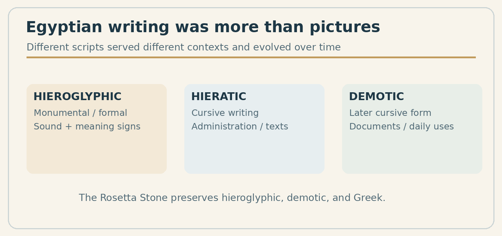

Egyptian hieroglyphs were visually striking signs used especially in monumental and formal contexts, but they were part of a broader writing tradition that also included cursive forms such as hieratic and later demotic. Writing combined signs that could represent sounds with other signs that identified meaning or word categories. It was not merely picture language in which each image corresponded to one obvious object. Many Egyptian inscriptions are readable today because linguists and historians reconstructed the language and its scripts through comparative evidence. \[<a href="/012-ancient-egypt-and-the-nile/sources/#source-21" class="cite">21</a>\]

The famous Rosetta Stone is a decree from 196 BCE inscribed in hieroglyphic script, demotic script and Greek. Its parallel texts contributed decisively to decipherment, together with the work of several scholars and the recognition that hieroglyphic writing could represent sounds. The stone did not suddenly supply every missing ancient text or translate itself. Jean-François Champollion made a decisive breakthrough in the early nineteenth century, building on earlier research including that of Thomas Young. \[<a href="/012-ancient-egypt-and-the-nile/sources/#source-21" class="cite">21</a>\]

<figure class="figure" id="figure-12-10">

<figcaption>Figure 12.10. Egyptian writing used several scripts; each developed over time and none is just a picture glossary. <a class="figure-anchor" href="#figure-12-10" aria-label="Link to this figure">#</a></figcaption>
</figure>

Administrative writing existed in inventories, letters and judicial documents, but literacy was not universal. A written system can empower officials and specialists as well as make claims durable. Indeed, a surviving decree may reveal an institution's preferred image of itself while concealing criticism and everyday disagreement. The historian therefore reads writing as an artifact with a producer, audience, purpose and transmission history.

One surprising detail is that Egyptian writing continued across immense historical changes. Coptic, a later stage of the Egyptian language written mainly in a Greek-derived script, survives as a liturgical language. Ancient Egyptian was not simply 'lost' in one instant when the last pharaoh died. Languages transform, institutions change and scripts can outlive the states that made them prestigious.
