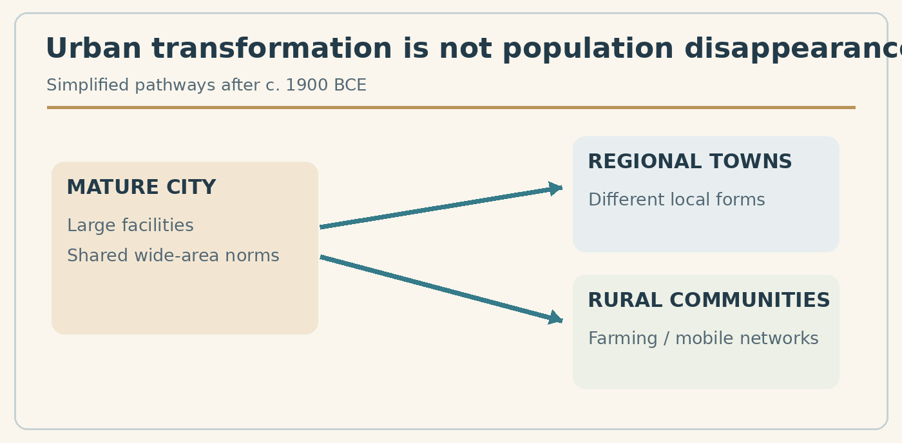

Around the turn of the second millennium BCE, the widespread Mature Harappan urban system changed. At a number of sites, large urban centers contracted or were no longer maintained in the same way. Long-distance exchanges, some standardized material forms, settlement densities and craft practices changed across regions. Many people lived on in smaller communities or moved into different areas; the overall pattern is often described as <em>de-urbanization</em> or regionalization rather than an instantaneous disappearance of the population. \[<a href="/013-the-indus-valley-civilization/sources/#source-6" class="cite">6</a>\]\[<a href="/013-the-indus-valley-civilization/sources/#source-8" class="cite">8</a>\]\[<a href="/013-the-indus-valley-civilization/sources/#source-20" class="cite">20</a>\]

Several interacting explanations have been proposed: environmental variation, reduced agricultural predictability, altered river patterns, changing trade, transformations in political and economic institutions, and other demographic or social processes. The evidence does not justify a single universal cause applied to every site. Importantly, older popular claims that invading armies destroyed all Harappan cities lack convincing archaeological support as a general explanation for the urban transition. Recognizing that does not mean declaring that no conflict occurred anywhere. \[<a href="/013-the-indus-valley-civilization/sources/#source-6" class="cite">6</a>\]\[<a href="/013-the-indus-valley-civilization/sources/#source-20" class="cite">20</a>\]

<figure class="figure" id="figure-13-11">

<figcaption>Figure 13.11. De-urbanization involves multiple pathways of community continuity and transformation. <a class="figure-anchor" href="#figure-13-11" aria-label="Link to this figure">#</a></figcaption>
</figure>

History often goes wrong when it equates the end of a visible state or urban style with the death of a culture. The fall of an empire does not mean its farmers vanished; the abandonment of monumental construction does not mean people forgot how to make a pot, sing, raise families or trade locally. In later Harappan contexts, archaeologists find continuities as well as new forms. The exact relationships between ancient populations and later communities must be investigated across many regions and periods, not proclaimed through a simple sentence about 'the descendants.'

Think back to Chapter 7 on systems. Urban life depends on a network of flows: food, fuel, water, specialized goods, trust and labor. A breakdown in one flow can make another flow more expensive or less reliable. Changes need not be dramatic to matter over a century. The Indus case offers a powerful introduction to historical complexity: an urban order can gradually lose the conditions that sustained its scale while human communities adapt and create different patterns of life.
