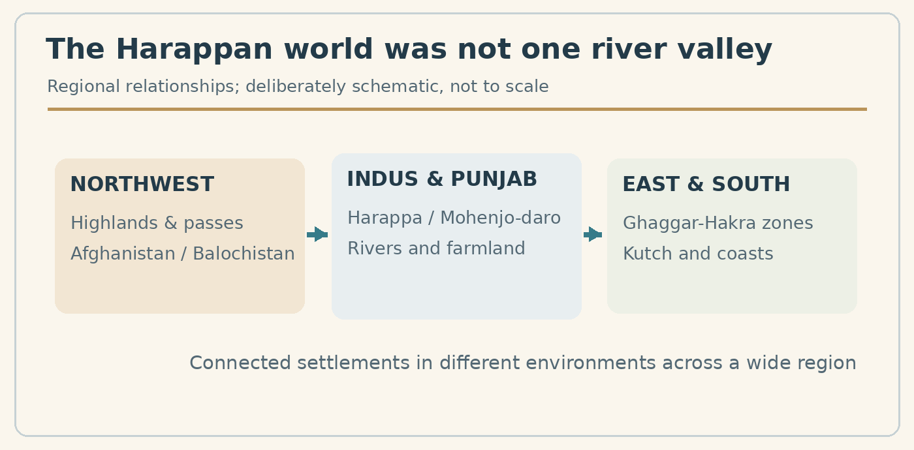

The 'Indus Valley Civilization' is a useful name, but its geographic reach went far beyond one valley. Sites belonging to the broader Harappan tradition appear across much of present-day Pakistan and northwestern India, with regional networks extending toward Afghanistan, the Arabian Sea coast, the western Himalayas and the margins of the Thar Desert. The heartland includes the Indus River and its tributaries, but sites also occur in semi-arid zones, along former channels and in coastal environments. Calling it an exclusively river-valley society hides some of the most interesting differences among its communities. \[<a href="/013-the-indus-valley-civilization/sources/#source-1" class="cite">1</a>\]\[<a href="/013-the-indus-valley-civilization/sources/#source-5" class="cite">5</a>\]

The Indus itself rises in a high mountain environment and flows generally southwestward through what is now Pakistan toward the Arabian Sea. Its great tributary system links the Punjab and neighboring regions. The region's environmental history is not a simple annual copy of Egypt's Nile story. Winter disturbances, summer monsoon rainfall, mountain snow and ice, local floods and shifting channels create complex regional patterns. Some settlements relied on nearby rivers, others on seasonal runoff, wells, reservoirs, local farming systems or access to trade routes. Different parts of the Harappan world experienced different risks. \[<a href="/013-the-indus-valley-civilization/sources/#source-6" class="cite">6</a>\]\[<a href="/013-the-indus-valley-civilization/sources/#source-7" class="cite">7</a>\]

A basic geographical rule matters here: a settlement's present-day position relative to a river is not proof of the river's ancient position. Watercourses shift, sediments accumulate, human activity changes drainage, and some ancient channels are now dry. A researcher must combine excavation, sediment studies, dating and environmental reconstruction rather than trace a modern blue line on a map backward four thousand years. Debate about channels often associated with the Ghaggar-Hakra system is an example of why distinguishing archaeological evidence from geographic mythology is essential. \[<a href="/013-the-indus-valley-civilization/sources/#source-7" class="cite">7</a>\]

<figure class="figure" id="figure-13-1">

<figcaption>Figure 13.1. The Harappan world linked many kinds of landscapes; schematic relationships are not a literal site map. <a class="figure-anchor" href="#figure-13-1" aria-label="Link to this figure">#</a></figcaption>
</figure>

Think of the Indus world as an interconnected mosaic. Its northern and inland centers had access to particular agricultural hinterlands; its western regions met routes through the Iranian plateau and Afghanistan; its southern coastal settlements could access marine resources and seaborne exchange. Shared forms of bricks, seals and weights connected many places, yet the people who used them lived in distinct landscapes. Geography helped make cooperation valuable while keeping every community's situation different.
