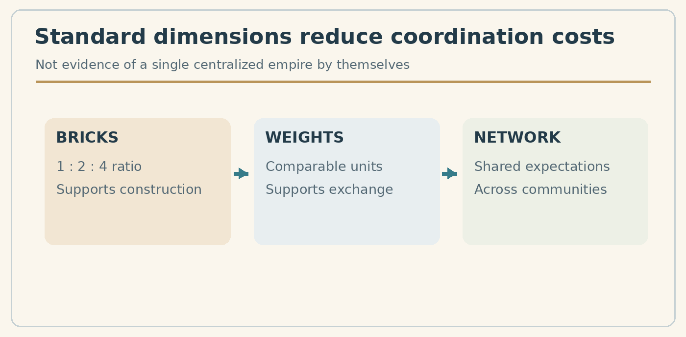

One of the strongest material signs of Harappan integration is the frequent use of standardized proportions in bricks and weights. A common brick proportion is 1:2:4 for thickness, width and length, though actual examples and practices varied across time, function and place. Carefully produced cubical weights, often made from chert, follow repeated conventions that allowed comparison and verification across transactions. Scholars have studied their systems and regional distributions rather than simply treating every similar brick as evidence of one bureaucrat's order. \[<a href="/013-the-indus-valley-civilization/sources/#source-10" class="cite">10</a>\]\[<a href="/013-the-indus-valley-civilization/sources/#source-13" class="cite">13</a>\]

<figure class="figure" id="figure-13-5">

<figcaption>Figure 13.5. Repeated brick proportions and weights could reduce construction and exchange costs. <a class="figure-anchor" href="#figure-13-5" aria-label="Link to this figure">#</a></figcaption>
</figure>

Why does standardization matter? Suppose two craft producers make bricks in incompatible dimensions. A builder must spend more time adapting courses and replacing materials. Or imagine merchants using weights with no shared reference: a claim of 'ten units' would be difficult to verify fairly across towns. Agreed standards lower some transaction and construction costs. They also create the need to enforce expectations and detect manipulation. Such expectations could be transmitted by skilled craftspeople, merchants, councils, institutions or forms of political authority. The objects do not reveal which mixture was decisive.

Notice that uniformity itself is an inference problem. If one excavator finds similar bricks at five sites, it does not follow that all building material across the region was identical. Measurements depend on which contexts survive and how objects are grouped. Strong archaeological argument reports variability as well as the repeated pattern. The existence of an impressive network-wide standard is compatible with a patchwork of local traditions.

An analogy from modern life is useful. Containers of standardized sizes can move among ships, trucks and warehouses run by different companies and governments. Shared standards enable exchange without proving one political sovereign controls the whole world. Harappan bricks and weights make a somewhat similar conceptual point—although we should never assume the ancient economic institutions were modern markets in miniature.
